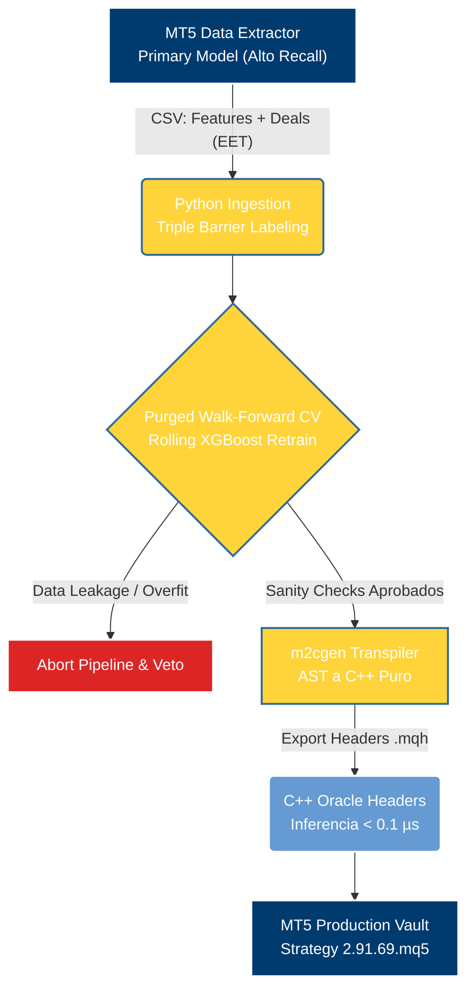

# M2 Quant Pipeline: Meta-Labeling Framework


> **Veredicto Científico:** Este repositorio fue concebido para someter a prueba rigurosa el *Edge* de la estrategia basada en la Media Móvil de Hull (HMA). Las evaluaciones empíricas de este pipeline demostraron que **las Medias Móviles sufren de *Alpha Decay* irreversible y no generan exceso de retorno en mercados electrónicos líquidos**. Se documenta el desmontaje científico de la HMA para evitar pérdidas de capital y consolidar un estándar institucional de auditoría cuantitativa.

Aunque la estrategia HMA murió, **la infraestructura construida aquí sobrevivió**. Este repositorio es un plano maestro institucional (*Blueprint*) que demuestra cómo diseñar, validar, transpolar a C++ y auditar modelos de *Machine Learning* para MetaTrader 5 a latencia cero (<0.1 μs).

---

## Arquitectura Core (M2 Pipeline)

El framework desacopla el ciclo cuantitativo en cuatro capas interconectadas:



---

## Crónica de Investigación en 4 Etapas

El ciclo completo de investigación se estructura en cuatro hitos técnicos documentados en el [Cuaderno de Investigación](docs/RESEARCH_JOURNAL.md):

1.  **[Etapa 1: Cinemática HMA y Alto Recall en $M_1$](docs/RESEARCH_JOURNAL.md#etapa-1-cinematica-de-la-hma-y-el-principio-de-alto-recall-en-meta-labeling):** Formulación cinemática (velocidad, aceleración y tirón) sobre la HMA de Alan Hull y la decisión anti-intuitiva de forzar sobre-operatividad en el modelo primario ($\text{Recall} \ge 0.85$) para generar un dataset denso ($N > 3.000$) y evitar el sesgo de truncamiento muestral.
2.  **[Etapa 2: Minería SQX y Sincronización Horaria](docs/RESEARCH_JOURNAL.md#etapa-2-mineria-con-strategyquant-x-sincronizacion-horaria-gmt0eet-y-filtros-mtf):** Minería genética con StrategyQuant X, corrección de la trampa del huso horario GMT+0 vs EET (vela espuria de domingo y ensanchamiento de spreads en rollover) e inyección vectorial de 7 variables continuas de régimen multitemporal (ADX H4, Keltner Bandwidth, ATR Ratio).
3.  **[Etapa 3: Transpilación a C++ a Latencia Cero (<0.1 μs)](docs/RESEARCH_JOURNAL.md#etapa-3-transpilacion-a-c-a-latencia-cero-en-metatrader-5):** Eliminación de cuellos de botella REST/Sockets en Python. Transpilación del grafo AST de XGBoost a cabeceras nativas C++/MQL5 (`M2_XGBoost_Oracle.mqh`) con ejecución sub-microsegundo protegida contra desbordamiento numérico (`MathExpSafe`).
4.  **[Etapa 4: Falsación Matemática Definitiva](docs/RESEARCH_JOURNAL.md#etapa-4-falsacion-matematica-definitiva-alpha-decay-y-la-trampa-del-market-beta):** Validación Purged Walk-Forward Montecarlo que desmanteló la ilusión de rentabilidad, demostrando que el balance alcista era $100\%$ *Market Beta* en Oro ($AUC_{\text{OOS}} = 0.518$) y exponiendo el retardo matemático insalvable frente a algoritmos institucionales HFT.

---

## Principios Cuantitativos Universales Transferibles

Los aprendizajes clave del proyecto han sido formalizados como principios institucionales de generalización universal en [Principios Cuantitativos Universales](docs/UNIVERSAL_PRINCIPLES.md):

*   **Principio 1: Descomposición Rigurosa de Alpha vs. Market Beta:** Formulación multifactorial Newey-West ($R_{p} = \alpha + \beta R_{m} + \epsilon$), pruebas de simetría direccional y aplicación del *Deflated Sharpe Ratio* (DSR) de Bailey y López de Prado para neutralizar el sesgo de selección en minería genética.
*   **Principio 2: Diseño del Tradeoff Precision/Recall en Meta-Labeling:** Justificación teórica de por qué el modelo primario debe optimizar exhaustividad ($\text{Recall} \to 1.0$), mientras el modelo secundario optimiza la precisión calibrada en función del Valor Esperado ($EV$) y modula el dimensionamiento continuo (*Bet Sizing*).
*   **Principio 3: Protocolo Institucional de Auditoría Previa a Capital Real:** El checklist de 5 puertas de auditoría (Cero Fuga Temporal, Paridad Horaria EET, Purged CV con $AUC_{\text{OOS}} \ge 0.55$, Degradación IS/OOS $\le 30\%$ y Latencia Nativa $<1\ \mu\text{s}$) antes de asignar capital real.

---

## Mapa del Repositorio

El repositorio está estrictamente organizado en dos ecosistemas técnicos y una bóveda documental:

- **`/python/m2_metalabeling/`**: El motor estadístico y de Machine Learning (Ingesta, Etiquetado Triple Barrera, Purged CV, Calibración y Transpilación).
- **`/mql5/`**: Código fuente de MetaTrader 5 (Extractores masivos de datos, cabeceras de oráculo C++ y Asesores Expertos de producción).
- **`/portfolio/`**: Bóvedas de producción multiactivo (AUDUSD, EURUSD, GBPJPY, GBPUSD, USDCHF, XAUUSD).
- **`/docs/`**: Portal de Documentación Científica (MkDocs Material).
- **`/tests/`**: Suite modular de pruebas automatizadas con `pytest`.

*(El portal web completo de documentación está disponible y publicado mediante **GitHub Pages**).*

---

## Guía de Trabajo: Flujo de Ejecución (Panel CLI)

Para orquestar el pipeline completo sin recurrir a scripts individuales, el repositorio cuenta con un panel orquestador interactivo y desatendido:

```bash
# Modo interactivo
python python/main.py

# Modo desatendido para automatización o integración continua
python python/main.py --all --non-interactive
python python/main.py --step 1 --non-interactive
```

Al ejecutarse interactivamente, se despliega el panel institucional:

```text
============================================================
    M2 QUANT PIPELINE - INSTITUTIONAL CONTROL PANEL     
============================================================
 Basado en Marcos López de Prado (Advances in Financial ML)
 Framework de latencia cero para MetaTrader 5
============================================================

[ FLUJO DE EJECUCIÓN (WORKFLOW) ]
  1. Ingestar Datos y Aplicar Triple-Barrera (Meta-Labeling)
  2. Entrenar Modelos (Purged Walk-Forward Montecarlo)
  3. Auditoría Estricta contra Fuga de Datos (Sanity Check)
  4. Transpilar Oráculo a C++ (MQL5 0ms Latency)
  5. Ejecutar Flujo Completo (Portfolio Auto-Batch)
```

---

## Navegación y Documentación Técnica

*   **[Metodología Cuantitativa](docs/METHODOLOGY.md):** Fundamentos matemáticos de la Triple Barrera, Purged CV con Embargo y transpilación C++.
*   **[Cuaderno de Investigación](docs/RESEARCH_JOURNAL.md):** Crónica detallada de las cuatro etapas del proyecto.
*   **[Principios Cuantitativos Universales](docs/UNIVERSAL_PRINCIPLES.md):** Lecciones institucionales transferibles a cualquier desarrollo sistemático.
*   **[Evolución Histórica de Prototipos](docs/HISTORICAL_EVOLUTION.md):** Recorrido por las versiones de asesores expertos, modelos ONNX y experimentos de RL.
*   **[Veredicto y Post-Mortem](docs/POST_MORTEM.md):** Análisis forense de la defunción del Alpha de la HMA y el examen de microestructura HFT.
