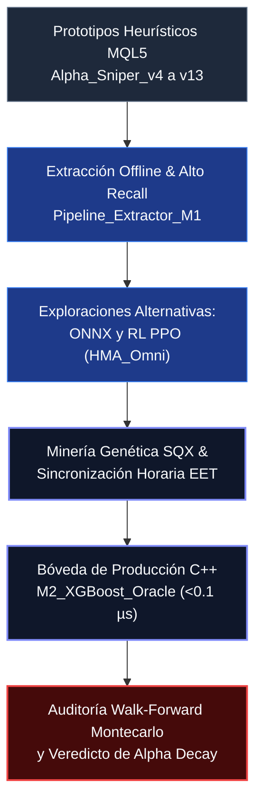

# Evolución de la Investigación: De Heurísticas a Machine Learning

Este documento traza la crónica técnica, la sucesión de prototipos algorítmicos y las lecciones aprendidas durante la evolución del proyecto HMA Meta-Labeling. Para un análisis cronológico exhaustivo por etapas con deducciones matemáticas completas, consulte el [Cuaderno de Investigación (Crónica Cuantitativa en 4 Etapas)](RESEARCH_JOURNAL.md).

---

## 1. La Era Heurística: Modelos MQL5 Estáticos

### 1.1 Premisa Inicial

Se formuló la hipótesis de que la cinemática de la Media Móvil de Hull (HMA) —específicamente sus puntos de inflexión angular (*V-Pivots*) y su aceleración— contenía una ventaja estadística predictiva (*Alpha*) capaz de anticipar rupturas de volatilidad e inicios de tendencia limpia en pares de divisas y metales preciosos:

$$
v_t = HMA_t - HMA_{t-1}, \quad a_t = v_t - v_{t-1}
$$

### 1.2 Implementación y Prototipos

*   **Desarrollo Heurístico (`Alpha_Sniper_v4.mq5` a `v13.mq5`):** Implementación en código MQL5 puro combinando períodos fijos de HMA y canales de volatilidad (*Keltner Bandwidth*).
*   **Salidas Rígidas:** Los primeros prototipos dependían de niveles fijos de Stop Loss y Take Profit en puntos. La rigidez de las salidas destruía la esperanza matemática en cuanto cambiaba la volatilidad del régimen de mercado. En versiones posteriores (`v11_2_EXP.mq5` a `v16_Core.mq5`) se incorporó un cálculo dinámico de barreras ajustado por el Rango Verdadero Medio (ATR).

### 1.3 Limitaciones Observadas

Las optimizaciones basadas en fuerza bruta y algoritmos genéticos dentro del probador de MetaTrader 5 generaban curvas de sobreajuste masivo. Los parámetros óptimos en el pasado colapsaban de inmediato en el periodo siguiente.

*   **Decisión Arquitectónica:** Abandonar los sistemas de reglas fijas condicionales y transitar hacia un clasificador probabilístico supervisado (*Machine Learning*).

---

## 2. Transición al Meta-Labeling y Recolección Offline

### 2.1 El Principio del Alto Recall

Para que un modelo de Machine Learning (XGBoost) aprenda de forma efectiva a filtrar señales, requiere un conjunto de entrenamiento amplio y representativo tanto de las dinámicas que generan ganancias como de las trampas de mercado que provocan pérdidas:

$$
\text{Recall}(M_1) = \frac{TP}{TP + FN} \to 1.0 \quad (\text{con } FN \to 0)
$$

*   **Permisividad Deliberada en $M_1$:** Reconfiguramos los Asesores Expertos primarios en MQL5 para ser extremadamente permisivos. El objetivo del modelo primario no era la rentabilidad, sino maximizar el **Recall** ($\text{Recall} \ge 0.85$), generando más de 3.000 operaciones en el histórico para nutrir al modelo secundario.
*   **Etiquetado por Triple Barrera:** En lugar de horizontes temporales fijos, se implementó el método de la Triple Barrera (López de Prado, 2018), asignando etiquetas basadas en el toque de barreras de Take Profit, Stop Loss o Timeout temporal.

### 2.2 Migración de Sockets a Extracción Offline

El intento preliminar de transmitir información tick a tick vía sockets IPC y APIs entre MetaTrader 5 y Python durante el proceso de optimización provocó cuellos de botella de latencia y bloqueos de memoria.

*   **Solución:** Desarrollo de `Pipeline_Extractor_M1.mq5` y `ML_Logger.mqh`, los cuales aprovechan el compilador optimizado de 64 bits de MT5 para volcar matrices de características a archivos CSV estructurados a la velocidad máxima del procesador.

---

## 3. Exploración de Vías Alternativas: ONNX y Reinforcement Learning

Durante las fases intermedias de la investigación se exploraron paradigmas alternativos para descartar que la debilidad del sistema residiera en la familia de modelos:

### 3.1 Exploración Trend-Following y Modelos ONNX (`HMA_TF`)

Se formuló la hipótesis de que filtrar las rupturas a favor de la tendencia macro reduciría drásticamente las señales falsas. Se diseñó el asesor `HMA_TF_v6_ONNX.mq5` incorporando modelos neuronales empacados en formato Open Neural Network Exchange (`.onnx`) ejecutados a través de la API nativa de MT5 (`OnnxCreate()`, `OnnxRun()`).

*   **Resultado:** Aunque la inferencia neuronal nativa en MT5 funcionaba correctamente, los modelos tendenciales mostraron alta sensibilidad al retardo temporal y una sobrecarga computacional innecesaria en comparación con árboles de decisión en C++.

### 3.2 Experimento de Aprendizaje por Refuerzo (`HMA_Omni`)

Se exploró el uso de Proximal Policy Optimization (PPO) con el objetivo de sustituir las etiquetas discretas por una función de recompensa continua basada en el Ratio de Sharpe de la curva de balance local.

*   **Resultado y Veredicto:** Los agentes de RL presentaron una volatilidad extrema ante pequeñas variaciones en la semilla aleatoria, problemas graves de convergencia y opacidad metodológica ("caja negra"). Era inviable auditar matemáticamente la fuga de datos o garantizar la estabilidad del riesgo en producción. Se decidió descartar el aprendizaje por refuerzo y centrar los esfuerzos en modelos supervisados interpretables y auditables (XGBoost).

---

## 4. Minería con StrategyQuant X y Corrección de Zona Horaria

### 4.1 Descubrimiento de Patrones MTF en SQX

Para extraer patrones primarios robustos sin sesgos subjetivos, se utilizó **StrategyQuant X (Build 141)**, generando millones de combinaciones de filtros de cinta de HMA. De este proceso surgió la arquitectura base **`Strategy 2.91.69.mq5`**.

### 4.2 La Trampa de Zona Horaria (GMT+0 vs EET)

Los datos históricos minados bajo el huso horario GMT+0 introducían una distorsión crítica en MetaTrader 5 (cuyos servidores bancarios operan en Eastern European Time, EET):

1.  **Vela de domingo espuria:** En GMT+0, la semana genera 6 velas diarias (con una vela artificial de domingo de 2 horas), alterando el cálculo de medias y ATR.
2.  **Desfase de velas H4:** Las barras de 4 horas abrían desincronizadas respecto a los períodos bancarios de liquidez.
3.  **Fricción de rollover:** Las operaciones abiertas en backtests en GMT+0 sufrían ensanchamientos masivos de spread en real entre las 23:00 y las 00:00 EET.

*   **Corrección:** Toda la base histórica se re-extrajo y re-procesó en horario EET, alineando perfectamente el entorno de prueba con el de producción.

---

## 5. Cuadro Comparativo de Prototipos Algorítmicos

La siguiente tabla resume la evolución de las arquitecturas evaluadas a lo largo de la investigación:

| Prototipo Algorítmico | Paradigma Técnico | Mecanismo de Salida | Inferencia / Latencia | Veredicto Cuantitativo |
|---|---|---|---|---|
| **Alpha_Sniper (v4 a v13)** | Heurística HMA M1 fija | Stop Loss / TP en puntos | Inmediata (MQL5 puro) | Sobreajuste MQL5 |
| **Pipeline_Extractor_M1** | Extracción masiva offline | N/A (Registro de datos) | Multihilo MT5 nativo | Éxito Operativo |
| **HMA_TF_v6_ONNX** | Red neuronal en ONNX | Filtro de tendencia macro | $0.5 - 2.0\text{ ms}$ (MT5 ONNX) | Retardo Temporal |
| **HMA_Omni_RL (PPO)** | Aprendizaje por refuerzo | Recompensa continua Sharpe | Inestable / Caja negra | Opacidad y Varianza |
| **Strategy 2.91.69 (SQX)** | Cintas HMA multitemporales | ATR dinámico H1/H4 | Inmediata (MQL5 puro) | GMT Trap / Paridad |
| **M2_XGBoost_Oracle** | Meta-Labeling C++ transpilado | Triple Barrera calibrada | **< 0.1 µs (C++ L1 Cache)** | Alpha Falsado |

---

*Para profundizar en los fundamentos matemáticos de este marco, consulte la [Metodología Cuantitativa](METHODOLOGY.md) y los [Principios Cuantitativos Universales](UNIVERSAL_PRINCIPLES.md).*
