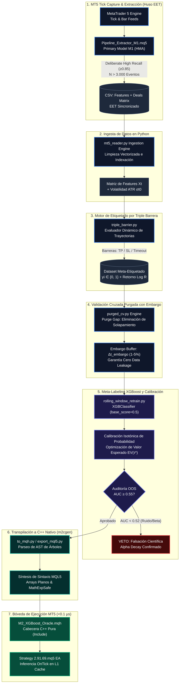
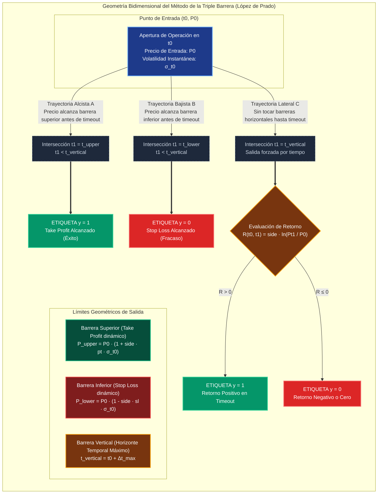
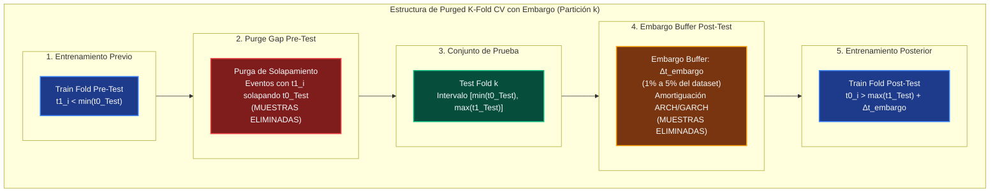

# Metodología Cuantitativa: El Framework M2


El Pipeline M2 no es un script de *Machine Learning* genérico, sino una infraestructura institucional basada en los fundamentos de las finanzas cuantitativas modernas enunciados por **Marcos López de Prado (*Advances in Financial Machine Learning*, 2018)**. 

Este documento detalla las formulaciones matemáticas rigurosas, los algoritmos de etiquetado, los esquemas de validación cruzada y los protocolos de transpilación que estructuran el proyecto.

---

## 0. Arquitectura Integral del Pipeline (End-to-End Execution Flow)

El ciclo cuantitativo desacopla la investigación, el etiquetado, la validación y la producción en siete componentes estrictamente orquestados:



---

## 1. El Paradigma de Meta-Labeling

### 1.1 Limitaciones de la Clasificación Direccional Estándar

En el enfoque tradicional de *Machine Learning* aplicado a mercados financieros, un modelo único intenta clasificar directamente la dirección futura del precio:

$$
\hat{y}_t = f(X_t) \in \{-1, 1\} \quad \text{o} \quad \{-1, 0, 1\}
$$

Este paradigma sufre de tres deficiencias estructurales:

1.  **Baja relación señal/ruido:** Las series de retornos financieros tienen un coeficiente de determinación típicamente inferior al 1% ($R^2 < 0.01$).
2.  **Confusión de objetivos:** Mezcla simultáneamente el descubrimiento de la oportunidad, la dirección del mercado y el dimensionamiento de la posición (*Bet Sizing*).
3.  **Sobreajuste extremo:** Al intentar predecir cada barra o tick, el modelo memoriza fluctuaciones aleatorias de microestructura.

### 1.2 Desacoplamiento en Dos Etapas (Two-Stage Architecture)

El marco de Meta-Labeling resuelve esta limitación dividiendo el problema en dos modelos especializados:

$$
\text{Decisión Final} = M_1(\text{Señal}) \times M_2(\text{Probabilidad de Éxito})
$$

1.  **Modelo Primario ($M_1$):** Genera la dirección $\text{side} \in \{-1, 1\}$ en base a una hipótesis técnica o cinemática (en este proyecto, la Media Móvil de Hull HMA). Su función primordial es actuar como un **generador de eventos**, maximizando el **Recall**:

    $$
    \text{Recall}(M_1) = \frac{TP}{TP + FN} \to 1.0 \quad (\text{con } FN \to 0)
    $$

    Acepta deliberadamente falsos positivos para proporcionar una base muestral densa y estadísticamente representativa.

2.  **Modelo Secundario ($M_2$):** Es un clasificador supervisado binario (XGBoost) que no predice la dirección, sino la veracidad o rentabilidad de la señal emitida por $M_1$:

    $$
    \begin{aligned}
    y_t &\in \{0, 1\} \\
    P(y_t = 1 \mid X_t) &= \text{Probabilidad condicional de rentabilidad del trade}
    \end{aligned}
    $$

Si $P(y_t = 1 \mid X_t) \ge \tau^*$ (umbral óptimo calibrado por valor esperado), la orden se ejecuta; en caso contrario, se descarta.

### 1.3 Límites Matemáticos y Condición de Frontera del Meta-Labeling

#### La Falacia del Meta-Labeling Milagroso

Existe una concepción errónea recurrente en la literatura cuantitativa que asume que el Meta-Labeling puede transformar cualquier regla heurística perdedora en una estrategia rentable mediante la superposición de un clasificador de *Machine Learning*. 

Formalmente, el Meta-Labeling formulado por López de Prado (2018) opera exclusivamente como un **modulador de tamaño de posición (*Bet Sizing*)** y un **filtro bayesiano de falsos positivos**. Su efectividad está subordinada a la existencia de una **ventaja estadística preexistente e irreducible en el generador primario ($M_1$)**.

#### Formulación de la Condición de Frontera

Sea un modelo primario $M_1$ que genera una secuencia de eventos de negociación con espacio de características $X \in \Omega$ y retornos logarítmicos realizados $R$. Descomponemos el retorno esperado del sistema combinado condicionado a la regla de filtrado $M_2(X) \ge \tau^*$:

$$
\mathbb{E}[R_{\text{final}}] = P(M_2(X) \ge \tau^*) \cdot \mathbb{E}\left[ R_{M_1} \;\middle|\; M_2(X) \ge \tau^* \right] - C_{\text{fricción}}
$$

Donde $C_{\text{fricción}}$ representa los costes fijos de microestructura (comisiones ECN, medio spread dinámico y slippage asimétrico de ejecución).

**Teorema de Frontera (Condición de Inexistencia de Alpha):**  
Si el modelo primario $M_1$ carece de ventaja estructural, tal que para toda partición admisible del espacio de estados $S \subset \Omega$:

$$
\mathbb{E}[R_{M_1} \mid X \in S] \le 0 \quad \forall S \subseteq \Omega \quad \text{en el dominio Out-of-Sample (OOS)}
$$

Entonces no existe ninguna función de decisión medible $M_2: \Omega \to [0, 1]$ ni umbral $\tau^* \in [0, 1]$ que satisfaga:

$$
\mathbb{E}[R_{\text{final}}] > 0 \quad \text{en datos no observados.}
$$

#### La Trampa del Modelo Primario Roto en In-Sample

Si la premisa primaria (en este caso, rupturas de volatilidad basadas en la cinemática de la HMA) está intrínsecamente viciada por retardo matemático frente a los creadores de mercado HFT, el espacio muestral In-Sample estará compuesto mayoritariamente por operaciones perdedoras y un subconjunto menor de aciertos aleatorios debidos al ruido o a la deriva del mercado (*Market Beta*).

Al entrenar un estimador flexible de alta capacidad (como `XGBClassifier` con árboles de profundidad $\ge 3$):
1. El clasificador secundario memoriza las correlaciones espurias de esos aciertos fortuitos dentro de muestra (*In-Sample Overfitting*).
2. Al proyectar el modelo hacia la ventana *Out-of-Sample* (OOS), las correlaciones desaparecen de inmediato.
3. El clasificador secundario colapsa hacia un poder discriminativo nulo:

$$
AUC_{\text{OOS}} \approx 0.50 \quad \text{(Indistinguible del azar)}
$$

O bien, para minimizar la entropía cruzada frente a un activo con deriva alcista (como el Oro en 2020-2026), clasifica prácticamente todos los eventos como válidos ($P(y=1) \to 1$), absorbiendo el $100\%$ del riesgo de mercado sin aportar ningún filtro real.

> **Principio de Diseño:** El Meta-Labeling actúa como un tamiz de alta precisión: puede separar el grano de la paja, pero si el saco contiene exclusivamente paja, ningún tamiz matemático producirá grano.

---

## 2. El Método de la Triple Barrera (Triple Barrier Method)

### 2.1 Geometría del Etiquetado

El etiquetado en horizontes temporales fijos ($t + h$) no refleja la mecánica de ejecución real de una mesa de negociación. El método de la Triple Barrera define una **caja geométrica bidimensional $(t, P)$** con tres horizontes dinámicos a partir del instante de apertura $t_0$:



### 2.2 Formulación Matemática de las Barreras

Las tres fronteras dinámicas se calculan a partir de la volatilidad local $\sigma_{t_0}$:

$$
\begin{cases}
P_{\text{upper}}(t) = P_0 \cdot \left(1 + \text{side} \cdot pt \cdot \sigma_{t_0}\right) & \text{(Barrera Superior / Take Profit dinámico)} \\
P_{\text{lower}}(t) = P_0 \cdot \left(1 - \text{side} \cdot sl \cdot \sigma_{t_0}\right) & \text{(Barrera Inferior / Stop Loss dinámico)} \\
t_{\text{vertical}} = t_0 + \Delta t_{\text{max}} & \text{(Barrera Vertical / Timeout temporal)}
\end{cases}
$$

Donde:

*   $P_0$: Precio de entrada en el instante $t_0$.
*   $\text{side} \in \{-1, 1\}$: Dirección de la señal emitida por $M_1$ ($+1$ para largos, $-1$ para cortos).
*   $pt, sl$: Multiplicadores de barrera (e.g., $pt = 2.0$, $sl = 1.0$).
*   $\sigma_{t_0}$: Estimador de volatilidad instantánea local, derivado del indicador Rango Verdadero Medio (ATR) normalizado:

$$
\sigma_{t_0} = \frac{ATR_{t_0}(14)}{P_0}
$$

### 2.3 Determinación del Tiempo de Salida y Asignación de Etiquetas

El tiempo de salida $t_1$ corresponde al primer evento que interseca cualquiera de las tres barreras:

$$
t_1 = \min\left( t_{\text{upper}}, t_{\text{lower}}, t_{\text{vertical}} \right)
$$

El retorno logarítmico realizado de la operación viene dado por:

$$
R(t_0, t_1) = \text{side} \cdot \ln\left( \frac{P_{t_1}}{P_{t_0}} \right)
$$

La etiqueta binaria $y_i$ utilizada para entrenar al modelo secundario se asigna conforme a la siguiente regla exhaustiva:

$$
y_i = \begin{cases} 
1 & \text{si } t_1 = t_{\text{upper}} \quad (\text{Take Profit alcanzado}) \\ 
0 & \text{si } t_1 = t_{\text{lower}} \quad (\text{Stop Loss alcanzado}) \\ 
1 & \text{si } t_1 = t_{\text{vertical}} \land R(t_0, t_1) > 0 \\ 
0 & \text{si } t_1 = t_{\text{vertical}} \land R(t_0, t_1) \le 0 
\end{cases}
$$

---

## 3. Validación Cruzada Purgada y con Embargo (Purged K-Fold CV)

### 3.1 El Fallo del K-Fold Convencional

El barajado aleatorio de datos (*Random K-Fold*) asume que las observaciones son independientes e idénticamente distribuidas (i.i.d.). En finanzas, los retornos presentan autocorrelación y, más importante aún, **las etiquetas de la Triple Barrera abarcan intervalos de tiempo superpuestos**:

$$
[t_{0, i}, t_{1, i}] \cap [t_{0, j}, t_{1, j}] \neq \emptyset
$$

Si una observación del conjunto de prueba finaliza en $t_{1, \text{test}}$ y una observación de entrenamiento comenzó en $t_{0, \text{train}} < t_{1, \text{test}}$, el modelo de entrenamiento recibe información del futuro (*Data Leakage*), produciendo métricas fraudulentamente optimistas.

### 3.2 Visualización Estructural de Purging y Embargo

Siguiendo a López de Prado (Capítulo 7), el algoritmo **Purged K-Fold con Embargo** garantiza la estricta independencia temporal de los conjuntos de datos:



Cronológicamente, la distribución se organiza en el siguiente diagrama temporal:

```mermaid
gantt
    title Cronograma de Purging y Embargo Temporal
    dateFormat X
    axisFormat %s
    section Partición Temporal
    Entrenamiento Previo (Train) :active, tr1, 0, 40
    Purga Pre-Test (Eliminación Solapamiento) :crit, p1, 38, 40
    Conjunto de Prueba (Test Fold k) :done, ts1, 40, 70
    Embargo Post-Test (Amortiguación GARCH) :crit, em1, 70, 75
    Entrenamiento Posterior (Train) :active, tr2, 75, 100
```



### 3.3 Formulación Matemática de Purging y Embargo

1.  **Purging (Purga de Solapamiento):** Se eliminan del conjunto de entrenamiento todas las observaciones cuyo intervalo de etiquetado se solape con el intervalo temporal del conjunto de prueba:

    $$
    \text{Train}_k^{\text{purged}} = \left\{ i \in \text{Train}_k \mid t_{1, i} < \min_{j \in \text{Test}_k}(t_{0, j}) \quad \lor \quad t_{0, i} > \max_{j \in \text{Test}_k}(t_{1, j}) \right\}
    $$

2.  **Embargo (Margen de Seguridad Post-Prueba):** Dado que los procesos de volatilidad presentan memoria autorregresiva de corto plazo (efectos ARCH/GARCH), se añade un período de embargo $\Delta t_{\text{embargo}}$ (1% al 5% del dataset) tras el final del set de prueba:

    $$
    \text{Train}_k^{\text{final}} = \text{Train}_k^{\text{purged}} \setminus \left\{ i \mid \max_{j \in \text{Test}_k}(t_{1, j}) \le t_{0, i} \le \max_{j \in \text{Test}_k}(t_{1, j}) + \Delta t_{\text{embargo}} \right\}
    $$

---

## 4. Calibración de Probabilidades y Bet Sizing

### 4.1 Calibración Isotónica (Isotonic Regression)

Los árboles de decisión de XGBoost optimizan la pérdida logística (*Log-Loss*), pero las probabilidades predichas $\hat{p}$ suelen concentrarse de forma distorsionada lejos de la diagonal de calibración real.

Para mapear la salida a probabilidades bayesianas fidedignas, se ajusta una **Regresión Isotónica** sobre un conjunto de calibración no observado:

$$
\min_{g} \sum_{i=1}^{N_{\text{cal}}} \left( y_i - g(\hat{p}_i) \right)^2 \quad \text{sujeto a } g(a) \le g(b) \quad \forall a < b
$$

Donde $g(\hat{p})$ es una función monótona no decreciente por tramos que garantiza que un puntaje predicho de $0.65$ equivalga a una tasa empírica de aciertos del $65\%$.

### 4.2 Dimensionamiento Continuo de Posición (Bet Sizing)

En lugar de una ejecución binaria (operar o no operar), la convicción del clasificador calibrado modula el tamaño del lote:

$$
s_t = \text{clip}\left( \frac{g(\hat{p}_t) - \tau^*}{1 - \tau^*}, 0.0, 1.0 \right) \cdot \text{Lote Máximo}
$$

Si $g(\hat{p}_t) < \tau^*$, el tamaño es cero (orden filtrada). A medida que $g(\hat{p}_t) \to 1.0$, el tamaño de posición escala linealmente hacia la asignación máxima de riesgo.

---

## 5. Transpilación a C++ Nativo a Latencia Cero

### 5.1 Comparativa de Arquitecturas de Ejecución

Para evaluar la viabilidad de ejecución en los servidores del bróker, se auditaron cuatro arquitecturas:

| Arquitectura de Ejecución | Latencia de Inferencia | Dependencias Runtime | Sobrecarga de Memoria | Viabilidad M1/Tick | Estado de Auditoría |
|---|---|---|---|---|---|
| **Python HTTP API (FastAPI)** | $35 - 75\text{ ms}$ | Uvicorn, Python, Red TCP | $> 250\text{ MB}$ | **Inviable** (Slippage letal) | <span class="badge badge--danger">Inviable</span> |
| **ZeroMQ IPC Sockets** | $5 - 15\text{ ms}$ | DLL ZeroMQ, Python activo | $> 180\text{ MB}$ | **Baja** (Bloqueos de hilos) | <span class="badge badge--warning">Baja</span> |
| **MT5 Nativo ONNX (`OnnxRun`)** | $0.5 - 2.0\text{ ms}$ | Runtime ONNX de MT5 | $\approx 25\text{ MB}$ | **Media** (Copia de tensores) | <span class="badge badge--info">Media</span> |
| **M2 C++ Nativo (`to_mqh.py`)** | **$< 0.1\ \mu\text{s}$ (<100 ns)** | **Cero dependencias** | **$< 200\text{ KB}$** | **Óptima** (CPU L1 Cache) | <span class="badge badge--success">Óptima (&lt;0.1 µs)</span> |

<div class="grid cards" markdown>

<div class="metric-card" markdown>
### Latencia de Inferencia C++
**< 0.1 µs (< 100 ns)**  
<span class="badge badge--success">Sub-Microsegundo</span>  
Inferencia ultra-rápida evaluada directamente en la memoria caché L1 de la CPU.
</div>

<div class="metric-card" markdown>
### Dependencias Runtime
**0 (Cero)**  
<span class="badge badge--success">Autocontenido</span>  
Sin microservicios, sin sockets ZeroMQ, sin intérprete de Python en producción.
</div>

<div class="metric-card" markdown>
### Sobrecarga de Memoria
**< 200 KB**  
<span class="badge badge--success">L1 Cache Fit</span>  
Código compilado plano compatible con los hilos de ejecución de MetaTrader 5.
</div>

<div class="metric-card" markdown>
### Paridad Numérica Python / MQL5
**Δ < 1.4 × 10⁻⁸**  
<span class="badge badge--success">Paridad Absoluta</span>  
Concordancia matemática exacta entre el modelo en Python y la inferencia C++.
</div>

</div>

### 5.2 Implementación del Transpilador de Árboles

El módulo `python/m2_metalabeling/export/to_mqh.py` toma el estimador `XGBClassifier` entrenado y transpila su grafo de árboles de decisión (AST) a código fuente MQL5 compilable.

=== "Python (Entrenamiento y Exportación)"
    ```python
    from m2_metalabeling.export.to_mqh import export_xgboost_to_mqh
    from xgboost import XGBClassifier

    # Entrenar modelo con base_score fijo obligatorio
    model = XGBClassifier(
        n_estimators=100,
        max_depth=3,
        learning_rate=0.05,
        base_score=0.5,
        random_state=42
    )
    model.fit(X_train, y_train)

    # Transpilar a cabecera C++ / MQL5 nativa
    export_xgboost_to_mqh(
        model=model,
        output_path="mql5/Include/M2_XGBoost_Oracle_XAUUSD.mqh",
        function_name="GetXGBoostProbability"
    )
    ```

=== "MQL5 / C++ (Inferencia Nativa en Bóveda)"
    ```cpp
    #property strict
    #include "M2_XGBoost_Oracle_XAUUSD.mqh"

    void OnTick()
    {
        // 1. Detección de señal del Primary Model (HMA)
        if (!IsHMABreakoutSignal()) return;

        // 2. Extracción de features vectorizadas en tiempo constante
        double features[7];
        features[0] = GetKeltnerBandwidthH4();
        features[1] = GetATRRatioH1D1();
        features[2] = GetADXValueH4();
        features[3] = GetADXSlopeH4();
        features[4] = GetDistEMA200H4();
        features[5] = GetBollingerWidthH1();
        features[6] = GetDailyExhaustion();

        // 3. Inferencia C++ a latencia cero (<0.1 microsegundos)
        double prob[2];
        GetXGBoostProbability(features, prob);

        // 4. Filtro de Meta-Labeling calibrado
        if (prob[1] >= XGBoostThreshold) {
            OpenExecution(ORDER_TYPE_BUY);
        } else {
            Print("Trade filtrado por Meta-Labeling. Prob: ", prob[1]);
        }
    }
    ```

La equivalencia numérica entre la predicción de Python y la inferencia transpilada en C++ fue validada empíricamente:

$$
\max_{x} \left| \hat{p}_{\text{Python}}(x) - \hat{p}_{\text{MQL5}}(x) \right| < 1.4 \times 10^{-8}
$$

---

*Para examinar la historia de desarrollo de esta arquitectura a lo largo de sus prototipos, consulte el [Cuaderno de Investigación](RESEARCH_JOURNAL.md) y los [Principios Cuantitativos Universales](UNIVERSAL_PRINCIPLES.md).*
