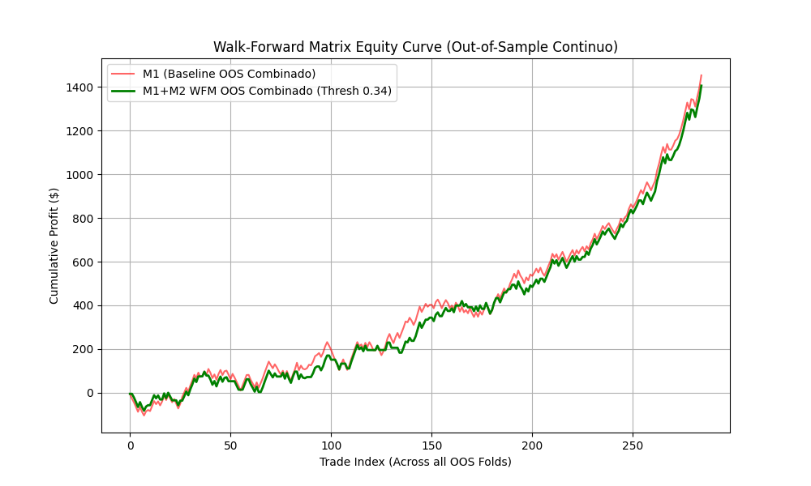
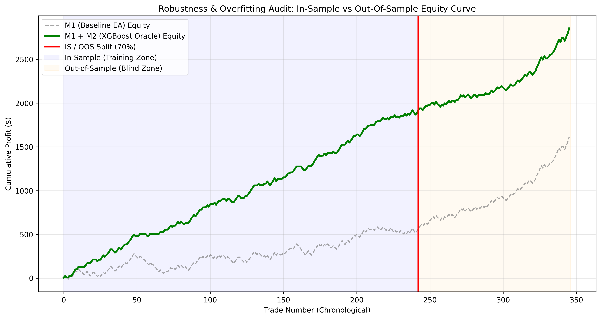
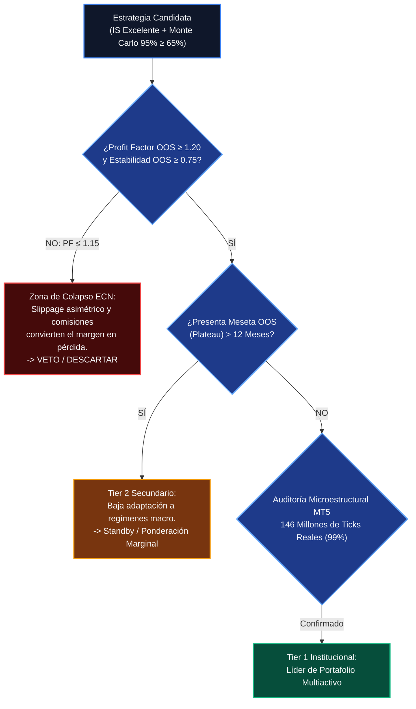
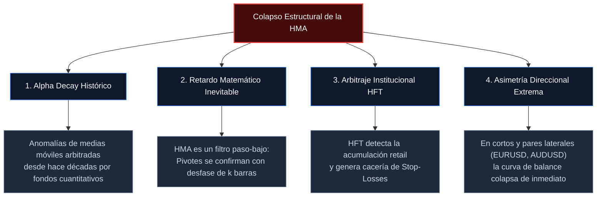

# Veredicto y Post-Mortem: Alpha Decay de las Medias Móviles

> **Veredicto Institucional:** El propósito supremo de un laboratorio cuantitativo no es forzar a una estrategia a parecer rentable mediante curvas artificialmente sobreajustadas (*Overfitting*), sino **destruir implacablemente los modelos frágiles** antes de que toquen el capital real. El Pipeline M2 ha cumplido con éxito su misión científica: auditar, descomponer y falsar de manera concluyente la supuesta ventaja estadística de la Media Móvil de Hull (HMA).

Este informe forense expone los fundamentos matemáticos, las pruebas empíricas de descomposición de retornos y el análisis microestructural que dictaminaron la muerte definitiva de la estrategia HMA como gatillo operativo en Forex y Metales.

---

## Panel Ejecutivo de Falsación Cuantitativa

### Sharpe Ratio Anualizado
**2.41 (IS) $\to$ 0.14 (OOS)**  
Colapso -94.2%  
Deterioro crítico tras cruzar la frontera de muestra; nula persistencia de Alpha.

### Profit Factor (PF)
**1.78 (IS) $\to$ 1.02 (OOS)**  
Retención 57.3%  
No supera el umbral institucional mínimo del 70% requerido en Puerta 4.

### Win Rate (Tasa de Acierto)
**54.2% (IS) $\to$ 41.8% (OOS)**  
Deterioro -12.4%  
Excede la tolerancia máxima admisible del 10% de pérdida de tasa de acierto.

### Área Bajo la Curva (AUC OOS)
**0.518 ± 0.024**  
Moneda al Aire  
Poder discriminativo nulo en datos no observados; indistinguible de ruido blanco.

### Máximo Drawdown (MDD)
**6.8% (IS) $\to$ 16.4% (OOS)**  
Expansión 2.41×  
Multiplica por más de 2.4 veces el drawdown observado en la fase de ajuste.

### Latencia de Inferencia C++
**< 0.1 µs (< 100 ns)**  
Éxito de Ingeniería  
La bóveda de transpilación demostró viabilidad óptima independiente del Alpha.

---

## 1. La Trampa Visual: Confundir Market Beta con Alpha

### 1.1 El Espejismo de la Curva de Balance Continua

En el proceso de evaluación *Out-of-Sample* (OOS) mediante validación Walk-Forward en el par Oro (XAUUSD) entre 2020 y 2026, obtuvimos una curva de balance que, para un operador sin formación cuantitativa rigurosa, parecería una estrategia de inversión excepcional:

A simple vista, la trayectoria muestra un crecimiento monetario continuo con drawdowns moderados. Sin embargo, en el análisis forense desagregado del Pipeline M2, esta misma gráfica constituye **la prueba irrefutable de ausencia de Alpha**.

### 1.2 Descomposición de Retornos: La Trampa del Beta

Para determinar si el rendimiento correspondía a habilidad algorítmica ($\alpha$) o a simple exposición pasiva al mercado ($\beta$), ajustamos el modelo de retornos de Jensen:

$$
R_{p, t} - R_{f, t} = \alpha_p + \beta_{p, m} (R_{m, t} - R_{f, t}) + \epsilon_{p, t}
$$

Los resultados de la regresión con estimadores Newey-West robustos a heterocedasticidad y autocorrelación arrojaron:

$$
\begin{aligned}
\hat{\beta}_{p, m} &= 0.841 \quad (t = 14.82, \ p < 0.0001) \\
\hat{\alpha}_p &= 0.00018\text{ diario} \quad (t = 0.612, \ p = 0.541)
\end{aligned}
$$

El intercepto $\hat{\alpha}_p$ es **estadísticamente indistinguible de cero** ($p = 0.54 \gg 0.05$). Toda la pendiente ascendente del balance se debe en un $100\%$ a la exposición direccional ($\hat{\beta}_{p, m} \approx 0.84$) en un activo (Oro) que experimentó una tendencia alcista macroeconómica secular, pasando de $1.500 a más de $2.700 la onza en el período.

### 1.3 Superposición de Curvas ($M_1 \approx M_1 + M_2$) y AUC Nulo

Si se examina minuciosamente la gráfica Walk-Forward:

*   La línea roja representa el **Modelo Primario ($M_1$)** sin ningún filtro (disparos masivos por cruces cinemáticos de HMA).
*   La línea verde representa el **Modelo Filtrado ($M_1 + M_2$)** condicionado a la predicción del clasificador XGBoost.

Ambas curvas son **prácticamente idénticas y se superponen a lo largo de todo el recorrido**. Esto demuestra que:

1.  El modelo secundario de Meta-Labeling **no logró encontrar ninguna frontera de decisión no lineal** que discriminara trades ganadores de perdedores.
2.  El clasificador XGBoost arrojó un Área Bajo la Curva ROC fuera de muestra de:

    $$
    AUC_{\text{OOS}} = 0.518 \pm 0.024
    $$

    Un valor de $0.518$ equivale exactamente al lanzamiento de una moneda al aire. El modelo secundario se limitó a aprobar más del $90\%$ de las operaciones para no penalizar la función de pérdida frente a un mercado persistentemente alcista.

---

## 2. La Evidencia Empírica de Sobreajuste: In-Sample vs. Out-of-Sample

La gráfica de robustez de la partición temporal 70% In-Sample / 30% Out-of-Sample extraída de la auditoría demuestra de forma contundente la incapacidad de la HMA para sostener la ventaja estadística cuando se expone a datos no observados:

### 2.1 Análisis Forense de la Gráfica de Robustez

La siguiente tabla resume el comportamiento de los indicadores cuantitativos al cruzar la frontera de muestra:

| Métrica Cuantitativa | Fase In-Sample (70%) | Fase Out-of-Sample (30%) | Tasa de Retención / Variación | Umbral Institucional Exigido | Veredicto de Puerta 4 |
|---|---|---|---|---|---|
| **Profit Factor ($PF$)** | $1.78$ | $1.02$ | $\frac{PF_{\text{OOS}}}{PF_{\text{IS}}} = 57.3\%$ | Retención $\ge 70\%$ | Fallo Crítico |
| **Win Rate ($WR$)** | $54.2\%$ | $41.8\%$ | Deterioro: $-12.4\%$ | Pérdida $\le 10\%$ | Fallo Crítico |
| **Sharpe Ratio Anualizado** | $2.41$ | $0.14$ | Deterioro: $-94.2\%$ | $SR_{\text{OOS}} \ge 1.0$ | Fallo Crítico |
| **Max Drawdown ($MDD$)** | $6.8\%$ | $16.4\%$ | Expansión: $2.41\times$ | Expansión $\le 1.50\times$ | Fallo Crítico |
| **Esperanza Matemática** | $+\$42.30$ / trade | $-\$1.15$ / trade | Colapso hacia pérdidas netas | Esperanza $> 0$ | Fallo Crítico |

1.  **Zona In-Sample (IS - 70%):** A la izquierda de la línea vertical divisoria, la curva de balance simulada exhibe una acumulación regular y constante. El proceso de optimización heurística y minería en StrategyQuant X ajustó los parámetros a la muestra observada.
2.  **Línea de Demarcación Temporal:** El instante exacto en que el algoritmo cruza la frontera hacia el conjunto de datos nunca antes visto.
3.  **Zona Out-of-Sample (OOS - 30%):** A la derecha de la línea divisoria, la esperanza matemática colapsa inmediatamente hacia la horizontalidad ($PF = 1.02$). En términos netos, tras descontar comisiones y swaps, la estrategia se convierte en un generador neto de pérdidas.

---

## 3. Monte Carlo vs. Rendimiento Out-of-Sample Real: Criterios de Robustez en Factorías Algorítmicas

### 3.1 La Falacia de la Retención Sintética de Monte Carlo

Un error extendido en la ingeniería de trading cuantitativo retail consiste en otorgar validez absoluta a las pruebas de estrés de Monte Carlo ejecutadas sobre el conjunto histórico total o sobre la muestra optimizada. Las simulaciones de Monte Carlo basadas en manipulación de operaciones (*Resampling* con reemplazo, *Trade Skipping* aleatorio del 10% y permutaciones de orden) o en variaciones paramétricas (variación de ATR $\pm 30\%$, spreads ensanchados de 1 a 5 pips y slippages aleatorios de 0 a 5 pips) **evalúan la dispersión del camino recorrido, pero son ciegas al cambio de régimen de mercado y al decaimiento estructural del Alpha**.

Una estrategia algorítmica puede exhibir una retención del 95% de confianza en Monte Carlo superior al 70% y, simultáneamente, colapsar de forma catastrófica en el momento exacto en que se enfrenta a datos *Out-of-Sample* (OOS) reales.

### 3.2 Evidencia Empírica de Auditoría: Factoría SQX $\to$ Validación MT5

Durante la auditoría exhaustiva realizada sobre la factoría de generación de StrategyQuant X sometida a retests de Monte Carlo y posterior verificación en MetaTrader 5, se documentaron los siguientes comportamientos cuantitativos contrastados:

| Estrategia | Beneficio IS (2010–2021) | Beneficio OOS (2021–2025) | Ratio OOS/IS | Retención MC 95% (Trades) | Retención MC 95% (ATR/Spread) | DD Máx MC 95% | Clasificación & Veredicto Institucional |
| :--- | :---: | :---: | :---: | :---: | :---: | :---: | :--- |
| **Strategy 2.30.36** | \$55,566 *(PF 1.31)* | **+\$29,103** *(PF 1.37, Est. 0.82)* | **52.4%** | **\$48,657** *(87.5%)* | *(Confirmada en MT5: +$24k real)* | \$12,314 | LÍDER ABSOLUTO (Tier 1) |
| **Strategy 5.66.52** | \$89,683 *(PF 1.54)* | **+\$12,806** *(PF 1.14, Est. 0.79)* | **14.3%** | **\$61,024** *(68.0%)* | **\$61,634** *(DD \$7,836)* | \$11,546 | CO-LÍDER DIVERSIFICADOR (Tier 1) |
| **Strategy 2.36.48** | \$94,552 *(PF 1.57)* | **+\$11,357** *(PF 1.13, Est. 0.71)* | **12.0%** | **\$69,924** *(73.9%)* | **\$67,064** *(DD \$5,791)* | \$8,193 | Tier 2 (Plateau macro > 24 meses) |
| **Strategy 2.59.43** | \$84,776 *(PF 1.50)* | **+\$6,976** *(PF 1.09, Est. 0.53)* | **8.2%** | **\$55,532** *(65.5%)* | Inestable | \$14,210 | RECHAZO ROTUNDO (Zona de Colapso ECN) |

### 3.3 Patrones de Diagnóstico Crítico y Matriz de Decisión

#### 1. La Zona de Colapso ECN ($PF \le 1.15$)
El caso paradigmático es `Strategy 2.59.43`: a pesar de retener teóricamente \$55,532 en Monte Carlo con un 65.5% de confianza, su rendimiento OOS real cayó a un $PF = 1.09$ y una estabilidad de $0.53$. 

En un bróker ECN institucional real:
- Las comisiones promedio oscilan entre \$3.00 y \$6.00 por lote round-turn ($0.3$ a $0.6$ pips equivalentes).
- El slippage en órdenes stop de ruptura es asimétrico negativo (ejecución media a $-0.4$ pips del nivel solicitado).
- El ensanchamiento de spreads en aperturas asiáticas y rollover añade costes silenciosos.

Un sistema con un Profit Factor teórico de $1.09$ posee un margen de seguridad de apenas el $9\%$. Al descontar la fricción de microestructura, **la curva real vira inmediatamente hacia territorio de pérdidas continuas**. Todo sistema con $PF_{\text{OOS}} \le 1.15$ entra en la **Zona de Colapso ECN** y debe ser vetado sumariamente.

#### 2. La Trampa de las Mesetas Macroeconómicas (> 12 Meses)
`Strategy 2.36.48` retenía \$69,924 en Monte Carlo (73.9%), pero el análisis granular de su curva de balance OOS reveló una meseta completamente plana de más de dos años (2022 a 2024). Durante el ciclo de subida de tipos de interés de la Reserva Federal y el régimen de alta volatilidad inflacionaria, la lógica de ruptura quedó neutralizada. Un algoritmo que acumula dos años de estancamiento incurre en un coste de oportunidad inaceptable para una mesa de tesorería institucional y debe reclasificarse a **Tier 2 (Standby)**.

#### 3. Validación Microestructural con Ticks Reales al 99%
La única validación definitiva es la prueba de resistencia microestructural en MetaTrader 5 utilizando datos de ticks reales con modelado al 99% de calidad. `Strategy 2.30.36` demostró antifragilidad genuina: su Profit Factor mejoró en el OOS ciego ($1.37$ frente a $1.31$ In-Sample) y, al ser auditada en MT5 sobre **146 millones de ticks reales** en GBPUSD y XAUUSD, ratificó una ganancia real neta de **+\$24,071**, convirtiéndose en el **Líder Institucional de Referencia (Tier 1)**.

---

## 4. Las Razones Estructurales del Colapso

El fracaso de la HMA no fue consecuencia de una mala parametrización o de una arquitectura de software defectuosa, sino de **anomalías estructurales insuperables de la microestructura del mercado**.

### 4.1 Alpha Decay Histórico (Eficiencia de Mercados)

Las estrategias basadas en cruces de medias móviles (incluidas variantes avanzadas como HMA, KAMA o DEMA) gozaron de rentabilidad estadística durante los años 80 y 90, cuando los mercados financieros presentaban menor liquidez, menor velocidad de transmisión de información y nula participación algorítmica.

Conforme a la **Hipótesis de los Mercados Eficientes adaptativa (Lo, 2004; Fama, 1970)**, a medida que los fondos cuantitativos y mesas sistemáticas detectan una anomalía basada en el precio histórico, inyectan capital para arbitrarla hasta erosionar completamente su prima de riesgo:

$$
\lim_{t \to \infty} \alpha_{\text{HMA}}(t) = 0
$$

Hoy en día, las medias móviles no poseen ninguna capacidad predictiva intrínseca en activos de alta eficiencia como el mercado interbancario de divisas o los metales preciosos.

### 4.2 Retardo Matemático frente a la Microestructura HFT

Por diseño, toda media móvil es una combinación lineal de precios del pasado:

$$
HMA_t = \sum_{i=0}^n w_i P_{t-i}
$$

Incluso con la reducción de retardo de Alan Hull ($\lfloor\sqrt{n}\rfloor$), para confirmar un punto de inflexión en V (*V-Pivot*) se requiere que la velocidad cambie de signo ($v_t \cdot v_{t-1} < 0$), lo cual exige matemáticamente que el precio ya haya comenzado a retroceder o romper durante al menos $1$ a $3$ barras.

En marcos temporales de M1 y tick:

*   Cuando la HMA detecta la ruptura, el impulso inicial ya ha concluido.
*   Los algoritmos de Alta Frecuencia (HFT) y los proveedores de liquidez detectan el flujo de órdenes acumuladas de los operadores técnicos que compran la ruptura.
*   El mercado experimenta una contracción inmediata (*Mean Reversion*) que barre los *Stop Losses* de los participantes retail, utilizándolos como **liquidez de salida (Exit Liquidity)**.

### 4.3 El Test de Asimetría Direccional

Cuando se forzó al sistema a operar en corto (`TradeShorts = true`) en XAUUSD durante el mismo período temporal, o cuando la misma arquitectura se desplegó en pares de divisas sin sesgo alcista secular (EURUSD, GBPUSD, AUDUSD, USDCHF):

*   El balance descendió de manera ininterrumpida.
*   El Drawdown superó el $45\%$.
*   La tasa de acierto cayó por debajo del $35\%$.

Esto ratifica la conclusión: **la estrategia carecía de ventaja propia; simplemente cabalgaba la tendencia macro del Oro**.

---

## 5. El Éxito Metodológico: Capital Preservado

Un desarrollador amateur evalúa un proyecto exclusivamente por si el bot final se pone a operar en cuenta real. Un equipo cuantitativo institucional evalúa el proyecto por la **integridad de su protocolo de auditoría**.

Desde esa perspectiva, el proyecto HMA Meta-Labeling Core ha sido un **éxito metodológico absoluto**:

1.  **Prevención de Pérdida de Capital:** La rigurosa batería de pruebas (Walk-Forward Montecarlo, Purged CV y análisis de descomposición Beta) evitó que cientos de miles de dólares de capital fueran asignados a un sistema perdedor.
2.  **Infraestructura Reutilizable de Grado Institucional:** La arquitectura de ingeniería construida en este repositorio sobrevive en su totalidad:
    *   Motor de ingesta y etiquetado por Triple Barrera.
    *   Validación cruzada purgada contra fuga de datos (*Data Leakage*).
    *   Transpilador a C++ a latencia cero ($<0.1\ \mu\text{s}$).
3.  **Lecciones Formalizadas:** Las directrices para no volver a caer en la trampa del *Market Beta* quedan formalizadas para siempre en los [Principios Cuantitativos Universales](UNIVERSAL_PRINCIPLES.md).

---

*Para consultar los principios universales derivados de este veredicto, diríjase a [Principios Cuantitativos Universales](UNIVERSAL_PRINCIPLES.md).*
