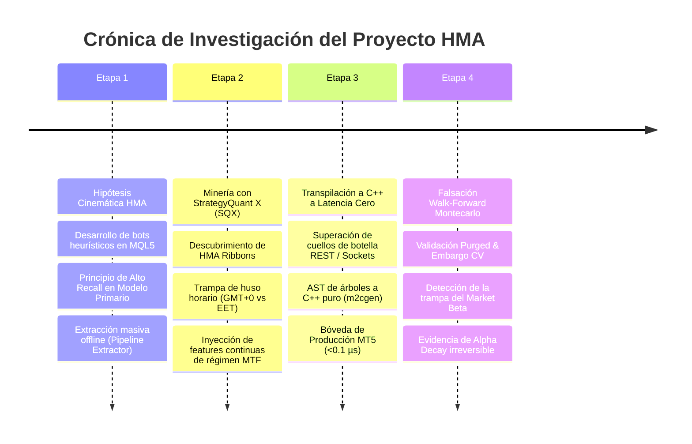
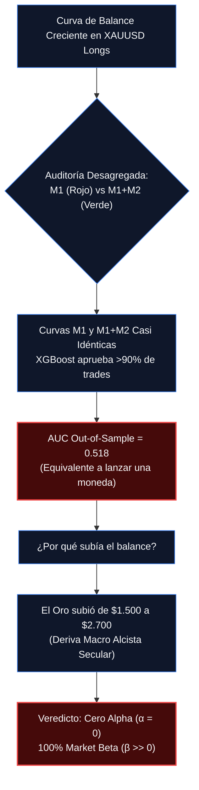

# Cuaderno de Investigación: Crónica Cuantitativa en 4 Etapas


Este documento constituye la memoria técnica y científica del proyecto HMA Meta-Labeling Core. A lo largo de su ciclo de vida, la investigación transitó por cuatro etapas metodológicas claramente delimitadas, evolucionando desde heurísticas geométricas en MQL5 hasta una infraestructura institucional de Machine Learning y su posterior falsación estadística definitiva.



---

## Etapa 1: Cinemática de la HMA y el Principio de Alto Recall en Meta-Labeling

### 1.1 La Hipótesis Cinemática de la Media Móvil de Hull

La investigación se originó con la premisa de que los puntos de inflexión y la velocidad angular de la **Media Móvil de Hull (Hull Moving Average - HMA)**, propuesta por Alan Hull en 2005, contenían capacidad predictiva (*Alpha*) para anticipar rupturas de volatilidad e inicios de impulsos direccionales en activos de alta liquidez.

La HMA fue diseñada para mitigar el retardo inherente a las medias móviles tradicionales (SMA y EMA) preservando la suavidad de la curva. Su formulación matemática se basa en la aplicación en cascada de Medias Móviles Ponderadas (WMA):

$$
WMA(P, n) = \frac{\sum_{i=0}^{n-1} (n - i) P_{t-i}}{\frac{n(n+1)}{2}}
$$

Hull descubrió que al restar una WMA de período completo a dos veces una WMA de medio período, se proyectaba el precio hacia adelante en el tiempo, cancelando el retardo de primer orden:

$$
\Delta WMA(P, n) = 2 \cdot WMA\left(P, \left\lfloor \frac{n}{2} \right\rfloor\right) - WMA(P, n)
$$

Para eliminar el ruido de alta frecuencia introducido por esta extrapolación, se aplica una WMA final con un período igual a la raíz cuadrada entera del período base:

$$
HMA(P, n) = WMA\left( \Delta WMA(P, n), \lfloor \sqrt{n} \rfloor \right)
$$

A partir de esta curva suavizada, formulamos las derivadas discretas de primer, segundo y tercer orden para capturar la dinámica cinemática del precio:

$$
\begin{aligned}
v_t &= HMA_t - HMA_{t-1} && \text{(Velocidad Instantánea)} \\
a_t &= v_t - v_{t-1} = HMA_t - 2HMA_{t-1} + HMA_{t-2} && \text{(Aceleración)} \\
j_t &= a_t - a_{t-1} = HMA_t - 3HMA_{t-1} + 3HMA_{t-2} - HMA_{t-3} && \text{(Tirón / Jerk)}
\end{aligned}
$$

El modelo primario inicial identificaba puntos de inflexión en V (*V-Pivots*) mediante el cambio de signo de la velocidad instantánea ($v_t \cdot v_{t-1} < 0$) condicionado a un umbral de deformación elástica (*Rubber Band Stretch*):

$$
\text{Stretch}_t = \frac{|P_t - HMA_t|}{ATR_t(14)} > \theta_{\text{stretch}}
$$

### 1.2 La Decisión Arquitectónica Anti-Intuitiva: Alto Recall en $M_1$

En los primeros ensayos manuales (`Alpha_Sniper_v4.mq5` a `v13.mq5`), se intentó optimizar filtros heurísticos en MQL5 (e.g., bandas de Bollinger, filtros de hora, RSI) para forzar al bot a tener una alta tasa de aciertos. Esto provocó dos problemas fatales:

1.  **Sobreajuste paramétrico brutal** en el probador de estrategias de MT5.
2.  **Colapso del número de operaciones ($N < 150$)**, destruyendo la significancia estadística.

Inspirados en el marco de **Meta-Labeling de Marcos López de Prado (*Advances in Financial Machine Learning*, 2018)**, adoptamos una decisión de diseño radicalmente distinta: **despojar al modelo primario de filtros restrictivos y convertirlo en un generador de eventos ultra-permisivo con alto Recall.**

$$
\text{Recall}(M_1) = \frac{TP}{TP + FN} \to 1.0 \quad (\text{con } FN \to 0)
$$


Al forzar al bot a operar prácticamente en cada cambio de pendiente de la HMA, acumulamos un dataset de más de 3.000 operaciones reales conteniendo tanto aciertos limpios como la totalidad de las trampas de volatilidad del mercado. Esto proporcionó al clasificador supervisado secundario ($M_2$) la densidad muestral necesaria para aprender qué combinaciones de contexto macro desaconsejan ejecutar la señal.

### 1.3 Extracción Masiva de Datos Offline

Intentar transmitir cada tick o barra mediante puentes socket en tiempo real entre MetaTrader 5 y Python durante la optimización generaba bloqueos de concurrencia y latencias inasumibles. 

Para resolverlo, desarrollamos `Pipeline_Extractor_M1.mq5` y la librería `ML_Logger.mqh`, los cuales aprovechan el motor multihilo de MT5 para ejecutar simulaciones históricas a nivel de tick en segundos y volcar la matriz completa de características a archivos CSV institucionales.

---

## Etapa 2: Minería con StrategyQuant X, Sincronización Horaria GMT+0/EET y Filtros MTF

### 2.1 Minería Algorítmica con StrategyQuant X (SQX)

Para eliminar el sesgo humano en la parametrización de las medias móviles, recurrimos a minería algorítmica mediante programación genética en **StrategyQuant X (Build 141)**. 

El proceso generó miles de arquitecturas de cruces y alineaciones de múltiples períodos (*HMA Ribbon*). De esta búsqueda emergió la arquitectura base **`Strategy 2.91.69.mq5`**, un sistema sobre gráfico M1 con confirmación de estructura en temporalidades superiores.

### 2.2 La Trampa del Huso Horario (GMT Offset Trap)

Al transferir los modelos minados en StrategyQuant X hacia el entorno de simulación y producción en MetaTrader 5, detectamos una discrepancia severa: estrategias con curvas de equity impecables en SQX colapsaban al ejecutarse en terminales de brokers institucionales.

La causa raíz fue identificada como **la trampa del huso horario GMT+0 vs EET (Eastern European Time)**:


1.  **La Vela Espuria de Domingo:** En feeds configurados en GMT+0, la apertura semanal de los domingos por la noche genera una vela diaria adicional de apenas 2 a 3 horas de negociación. Esto provoca que la semana tenga 6 velas en lugar de 5, descalibrando de forma irreversible indicadores con memoria temporal (como el ATR de 14 períodos o el ADX).
2.  **Desfase de Apertura en Velas H4:** Las barras de 4 horas calculadas en GMT+0 abren a las 00:00, 04:00, 08:00... mientras que en servidores EET abren a las 02:00, 06:00, 10:00... alterando por completo las condiciones de ruptura y los pivotes de máximos y mínimos.
3.  **Explosión de Spreads en el Rollover Bancario:** En la transición entre el cierre de Nueva York y la apertura de Sídney (21:00-22:00 GMT / 23:00-00:00 EET), la liquidez interbancaria se seca y los brokers ensanchan los spreads hasta $10\times$. Las estrategias simuladas en GMT+0 sin modelado de rollover tomaban operaciones en horas nocturnas que en la realidad eran devoradas por la fricción del spread.

**Solución Implementada:** Se reconstruyeron íntegramente todas las bases de datos de extracción y reentrenamiento bajo el huso horario oficial del bróker (EET / GMT+2 con horario de verano GMT+3), garantizando que cada barra en Python coincidiera exactamente con la barra en MT5.

### 2.3 Inyección de Features Continuas de Régimen Multitemporal (MTF)

En lugar de imponer filtros condicionales discretos en MQL5 (`if (ADX_H4 > 25)`), los cuales son frágiles y conducen a sobreajuste, se optó por **vectorizar el contexto macro** e inyectarlo como variables continuas en el espacio dimensional de $M_2$:

1.  `Keltner_Bandwidth_H4`: Ancho relativo del canal Keltner en H4 (régimen de expansión vs contracción de volatilidad).
2.  `ATR_Ratio_H1_D1`: Cociente entre la volatilidad de corto plazo (H1) y la volatilidad estructural (D1).
3.  `ADX_Value_H4`: Intensidad tendencial macro en H4.
4.  `ADX_Slope_H4`: Derivada de la fuerza tendencial en H4.
5.  `Dist_EMA200_H4`: Distancia porcentual del precio a la media móvil exponencial institucional de 200 períodos.
6.  `Bollinger_Width_H1`: Compresión de volatilidad previa al breakout en H1.
7.  `Daily_Exhaustion`: Medida de agotamiento del rango diario proyectado.

---

## Etapa 3: Transpilación a C++ a Latencia Cero en MetaTrader 5

### 3.1 La Crisis de la Latencia de Ejecución

Una vez entrenado el clasificador XGBoost en Python, se evaluaron distintas alternativas de arquitectura para poner el modelo en producción dentro de MetaTrader 5:

| Arquitectura de Integración | Latencia Típica por Inferencia | Dependencias en Producción | Resistencia a Slippage HFT | Estado de Evaluación |
|---|---|---|---|---|
| **Microservicio REST (HTTP/FastAPI)** | $30 - 80\text{ ms}$ | Servidor Python, Flask/FastAPI, Red local | **Nula** (Slippage severo en M1) | <span class="badge badge--danger">Inviable</span> |
| **Sockets IPC (ZeroMQ / Named Pipes)**| $5 - 20\text{ ms}$ | Runtime Python activo, Librerías DLL | **Baja** (Bloqueos de subprocesos) | <span class="badge badge--warning">Baja</span> |
| **Modelo ONNX Nativo MT5 (`OnnxRun`)**| $0.5 - 2.0\text{ ms}$ | Runtime ONNX de MT5, Tensores dinámicos | **Media** (Sobrecarga de copia de memoria) | <span class="badge badge--info">Media</span> |
| **Transpilación C++ Nativa (M2 Core)**| **$< 0.1\ \mu\text{s}$ (<100 ns)** | **Cero dependencias externas** | **Máxima** (CPU L1 Cache) | <span class="badge badge--success">Óptima (&lt;0.1 µs)</span> |

En operativas de ruptura (*Breakout*) sobre velas M1 o ticks, un retardo de 50 milisegundos significa que los proveedores de liquidez y algoritmos HFT ya habrán absorbido el volumen disponible, desplazando el precio de ejecución (*Slippage*) y destruyendo el valor esperado del trade.

### 3.2 Transpilación AST con `m2cgen` y Adaptación para MQL5

Para lograr ejecución a latencia cero, implementamos la transpilación directa del árbol de decisión de XGBoost a código C ANSI puro utilizando `m2cgen`. Sin embargo, el compilador de MetaQuotes (MetaEditor / MQL5) no es un compilador C99 estándar y rechaza varias construcciones generadas automáticamente.

El pipeline de exportación (`python/m2_metalabeling/export/to_mqh.py` y `export_mql5.py`) resolvió seis incompatibilidades sintácticas:

1.  **Asignación de Arrays:** MQL5 prohíbe los literales compuestos de C99 como `memcpy(output, (double[]){...}, ...)`. El transpilador reescribe estas instrucciones mediante asignaciones indexadas directas:

    ```cpp
    result[0] = 1.0 - varX;
    result[1] = varX;
    ```

2.  **Paso de Parámetros por Referencia:** Sustitución de punteros genéricos `double *` por arrays pasados por referencia constante:

    ```cpp
    void GetXGBoostProbability(const double &features[], double &result[])
    ```

3.  **Protección contra Desbordamiento Numérico (`MathExpSafe`):** Cuando la acumulación de predictores de árboles en XGBoost genera márgenes $|x| > 100$, la función exponencial estándar desborda hacia `inf` o genera `NaN`. Se implementó una sigmoide simétrica numéricamente acotada:

    ```cpp
    double MathExpSafe(double x) {
        if (x > 100.0) return MathExp(100.0);
        if (x < -100.0) return MathExp(-100.0);
        return MathExp(x);
    }

    double sigmoid(double x) {
        if (x < 0.0) {
            double z = MathExpSafe(x);
            return z / (1.0 + z);
        }
        return 1.0 / (1.0 + MathExpSafe(-x));
    }
    ```

### 3.3 La Bóveda de Ejecución (Execution Vault)

El modelo transpilado se compila como una cabecera `.mqh` independiente (`M2_XGBoost_Oracle_<SYMBOL>.mqh`). 

El Asesor Experto maestro en MetaTrader 5 (`Strategy_<SYMBOL>_Production.mq5`) únicamente requiere incluir la cabecera:

```cpp
#include "M2_XGBoost_Oracle_XAUUSD.mqh"

// En el evento de evaluación de señal:
double features[7];
// [Extracción de variables de régimen...]
double prob[2];
GetXGBoostProbability(features, prob);

if (prob[1] >= XGBoostThreshold) {
    OpenPosition(ORDER_TYPE_BUY);
}
```

Esta arquitectura permite que el oráculo se ejecute en **menos de 100 nanosegundos**, directamente en la memoria caché del procesador, sin interactuar con ningún software externo durante la operativa en vivo.

---

## Etapa 4: Falsación Matemática Definitiva (Alpha Decay y la Trampa del Market Beta)

### 4.1 La Validación Purged Walk-Forward Montecarlo

Con la infraestructura de datos y la bóveda de ejecución finalizadas, sometimos el sistema completo a una auditoría estricta de validación cruzada purgada y rodante (*Purged Walk-Forward Montecarlo*).

A diferencia de los backtests tradicionales que evalúan un único periodo histórico estático, el pipeline ejecutó múltiples ventanas rodantes temporales con *Purging* (eliminación de solapamiento de barreras) y *Embargo* (vacío de correlación serial), simulando el paso secuencial de los modelos a producción real.

### 4.2 La Ilusión del Market Beta: El Desmontaje Empírico

Al ejecutar la validación sobre el par Oro (XAUUSD) en modo compras exclusivas (*Long-Only*) entre 2020 y 2026, el resultado preliminar parecía extraordinario: una curva de balance con crecimiento exponencial continuo.

Sin embargo, el análisis cuantitativo profundo reveló la verdad:




1.  **Superposición Absoluta de Curvas ($M_1 \approx M_1 + M_2$):** En la gráfica de Walk-Forward, la línea del modelo base sin filtrar ($M_1$, rojo) y la línea del modelo filtrado por Machine Learning ($M_1+M_2$, verde) son prácticamente indistinguibles. XGBoost no encontró ninguna frontera estadística real para mejorar al modelo primario; simplemente aprobaba la gran mayoría de operaciones.
2.  **Métrica AUC Nula en OOS:** El Área Bajo la Curva ROC del clasificador XGBoost fuera de muestra (*Out-of-Sample*) promedió un valor de $0.518$, lo cual es estadísticamente idéntico a una asignación aleatoria (moneda al aire).
3.  **Captura Pasiva de la Tendencia:** Dado que en la Etapa 1 habíamos configurado deliberadamente a $M_1$ para sobre-operar en compras con alto Recall, el bot ejecutaba cientos de posiciones largas en un activo que duplicó su valor nominal en el periodo analizado. Cualquier estrategia que comprara oro con frecuencia habría mostrado una curva idéntica.
4.  **Colapso en Cortos y en Otros Activos:** Cuando se activó la operativa en corto (`TradeShorts = true`) en XAUUSD, o cuando el mismo sistema se desplegó en pares de divisas con comportamiento lateral o sin tendencia secular (EURUSD, AUDUSD, USDCHF), **la curva de equity colapsó con drawdowns catastróficos**.

### 4.3 Evidencia Empírica de Divergencia In-Sample vs Out-of-Sample

La gráfica de robustez de la división 70% In-Sample / 30% Out-of-Sample documenta de forma irrefutable el sobreajuste del modelo primario y la incapacidad de la HMA para sostener la ventaja:


*Análisis cuantitativo de la gráfica:*

*   **Fase In-Sample (Primer 70% de las operaciones):** Rendimiento constante, pendiente de acumulación positiva y control aparente de volatilidad. El algoritmo parecía haber descubierto una ineficiencia robusta.
*   **Frontera de Muestra (Línea vertical divisoria):** Separación estricta de datos nunca vistos por el proceso de minería.
*   **Fase Out-of-Sample (Último 30%):** Estancamiento inmediato, aplanamiento de la esperanza matemática y deterioro progresivo hacia rendimientos nulos.

### 4.4 El Fenómeno Estructural: Retardo Matemático frente al Arbitraje HFT

El análisis final de microestructura arrojó la explicación matemática definitiva de por qué la Media Móvil de Hull no puede generar Alpha en los mercados electrónicos modernos:

1.  **Retardo Matemático Inevitable:** Por muy optimizada que esté la ponderación WMA de Alan Hull, una media móvil es formalmente un filtro paso-bajo que opera sobre precios pasados:

    $$
    HMA_t = \sum_{i=0}^k w_i P_{t-i}
    $$

    El punto de inflexión en V (*V-Pivot*) se confirma necesariamente varias barras después del mínimo o máximo real del precio.

2.  **Cacería de Liquidez por Algoritmos HFT:** Los creadores de mercado institucionales y algoritmos de alta frecuencia monitorizan la concentración de órdenes de los participantes retail que operan rompimientos de medias móviles. Cuando el algoritmo retail genera la señal de compra al confirmarse el giro de la media, el precio ya ha recorrido el impulso inicial; los participantes institucionales utilizan ese flujo de órdenes entrantes como liquidez de salida (*Exit Liquidity*), forzando retrocesos inmediatos que barren los *Stop Losses*.

---

## Cuadro Comparativo de la Evolución de la Investigación

| Dimensión Analizada | Etapa 1: Heurística HMA | Etapa 2: Minería SQX & GMT | Etapa 3: Transpilación C++ | Etapa 4: Falsación Final |
|---|---|---|---|---|
| **Paradigma Operativo** | Disparo por giro de HMA | Alineación de cintas MTF | Oráculo Meta-Labeling C++ | Auditoría de Alpha vs Beta |
| **Filtro de Ruido** | Reglas rígidas en MQL5 | ADX H4 condicional | Features macro continuas | Rechazo por falta de Alpha |
| **Latencia de Inferencia** | Inmediata (heurística) | Inmediata (heurística) | **< 0.1 µs (Nativo C++)** | N/A (Fase de auditoría) |
| **Huso Horario** | Indiferenciado | Corrección obligada a EET | EET sincronizado | Auditoría estricta de rollover |
| **Métrica Clave IS** | Win Rate local | Profit Factor genético | Accuracy > 68% | Sharpe IS > 2.0 |
| **Métrica Clave OOS** | No evaluada rigurosamente | Degeneración en backtest | AUC OOS ≈ 0.52 | **AUC OOS = 0.518** |
| **Veredicto Institucional** | <span class="badge badge--info">Requiere ML</span> | <span class="badge badge--warning">Paridad Horaria</span> | <span class="badge badge--success">Transpilación Exitosa</span> | <span class="badge badge--danger">Estrategia Rechazada</span> |

---

*Para profundizar en el marco formal de auditoría y en las lecciones transferibles a otros sistemas algorítmicos, continúe hacia los [Principios Cuantitativos Universales](UNIVERSAL_PRINCIPLES.md) y el análisis forense final en el [Veredicto y Post-Mortem](POST_MORTEM.md).*
