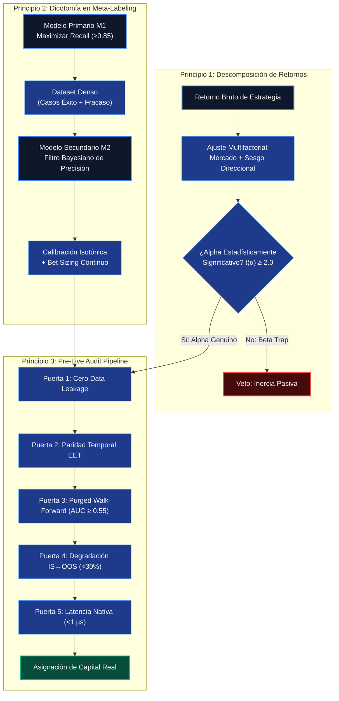
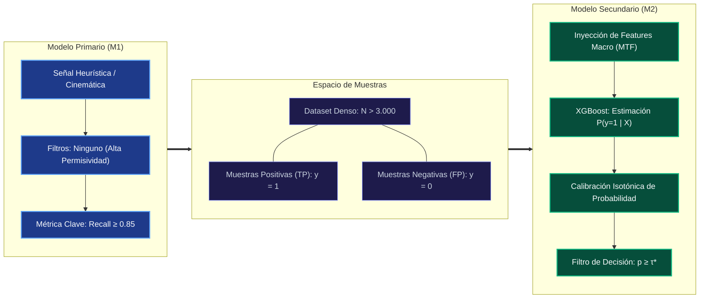
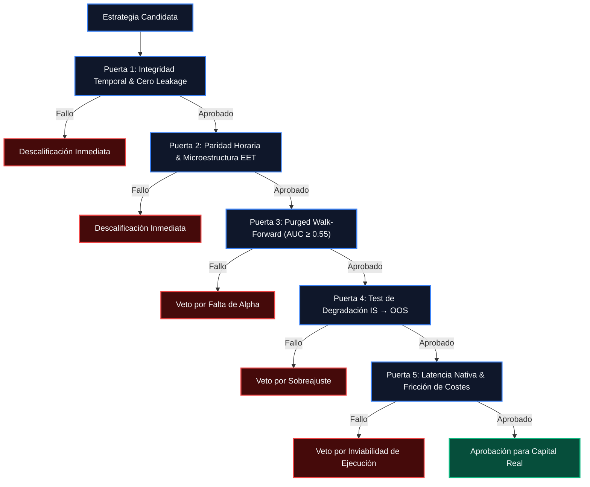

# Principios Cuantitativos Universales

> **Premisa Fundamental:** En finanzas cuantitativas, la gran mayoría de los sistemas que parecen rentables en simulaciones históricas son artefactos estadísticos de sobreajuste (*Overfitting*), sesgo de supervivencia (*Survivorship Bias*) o absorción pasiva del movimiento general del mercado (*Market Beta*). Un proceso de grado institucional no busca validar una estrategia a toda costa; su objetivo es **falsarla metódicamente** antes de exponer un solo dólar de capital real.

A partir del desarrollo, auditoría y desmontaje empírico del proyecto HMA Meta-Labeling, se formalizan a continuación **tres principios cuantitativos universales y transferibles** aplicables a cualquier clase de activo (FX, materias primas, renta variable, criptoactivos o futuros).

---

## Principio 1: Descomposición Rigurosa de Alpha vs. Market Beta

> *Toda estrategia que no demuestre Alpha estadísticamente significativo tras aislar la deriva de mercado y el sesgo direccional es un vehículo pasivo encubierto con riesgo crítico de ruina en cambios de régimen.*

### 1.1 El Modelo de Retornos Multifactorial

El rendimiento bruto de una estrategia algorítmica $R_{p, t}$ en exceso de la tasa libre de riesgo $R_{f, t}$ debe descomponerse formalmente en sus componentes de mercado y factores sistemáticos:

$$
R_{p, t} - R_{f, t} = \alpha_p + \beta_{p, m} (R_{m, t} - R_{f, t}) + \sum_{k=1}^K \beta_{p, k} F_{k, t} + \epsilon_{p, t}
$$

Donde:

*   $\alpha_p$: **Alpha genuino**, que representa el exceso de retorno idiosincrásico derivado de la habilidad del algoritmo, independiente de las fluctuaciones del mercado.
*   $\beta_{p, m}$: Exposición lineal al factor de mercado o activo base ($R_{m, t}$).
*   $F_{k, t}$: Factores de riesgo sistemáticos (e.g., Momento, Volatilidad, Carry o Liquidez).
*   $\epsilon_{p, t}$: Término de error de media cero residual e incorrelacionado.

Para aceptar la existencia de una ventaja cuantitativa válida, se debe contrastar la hipótesis nula de ausencia de Alpha:

$$
H_0: \alpha_p = 0 \quad \text{vs} \quad H_1: \alpha_p > 0
$$

El estadístico $t$ de Student del estimador $\hat{\alpha}_p$ bajo errores estándar robustos a heterocedasticidad y autocorrelación (Newey-West HAC) debe satisfacer:

$$
t(\hat{\alpha}_p) = \frac{\hat{\alpha}_p}{\text{SE}_{\text{HAC}}(\hat{\alpha}_p)} \ge 2.0 \quad (p\text{-valor} < 0.05)
$$

Si $\hat{\beta}_{p, m} \gg 0$ y $t(\hat{\alpha}_p) < 2.0$, la curva de ganancias observada es un subproducto del *Market Beta*: el algoritmo únicamente funcionó porque el activo base subió (en estrategias *long-only*) o cayó (en estrategias *short-only*).

### 1.2 La Prueba de Simetría Direccional (Directional Symmetry Test)

Un síntoma recurrente de falso Alpha es la asimetría operativa: estrategias que exhiben excelentes métricas operando exclusivamente en largo en activos con tendencia secular alcista (como el Oro o índices bursátiles).

Para descartar el sesgo direccional, se exige someter el sistema a la **Prueba de Simetría Direccional**:

1.  **Operatividad Espejo:** Evaluar la misma lógica algorítmica para entradas en corto bajo condiciones matemáticas equivalentes.
2.  **Evaluación Multiactivo:** Someter el modelo a activos de correlación nula o mercados en rango lateral (e.g., EURUSD, AUDUSD, USDCHF).
3.  **Neutralización de Tendencia (Detrending):** Restar la deriva media del activo $\mu_m = \frac{1}{T} \sum_{t=1}^T R_{m, t}$ a los retornos subyacentes antes de simular las señales. Si el Sharpe Ratio colapsa a valores $\le 0$, el sistema carece de Alpha propio.

### 1.3 Deflated Sharpe Ratio (DSR) frente a Múltiples Ensayos

Cuando un equipo cuantitativo explora múltiples combinaciones de parámetros, reglas o configuraciones en herramientas como StrategyQuant X o algoritmos genéticos, el Ratio de Sharpe máximo observado está severamente inflado por el sesgo de selección (*Selection Bias*).

Siguiendo a **Bailey y López de Prado (2014)**, el **Deflated Sharpe Ratio (DSR)** corrige el Ratio de Sharpe considerando el número de ensayos independientes ($K$), la asimetría ($\hat{\gamma}_3$) y la curtosis ($\hat{\gamma}_4$) de la distribución de retornos:

$$
DSR = \Phi\left( \frac{(\widehat{SR} - SR_0)\sqrt{T-1}}{\sqrt{1 - \hat{\gamma}_3 \widehat{SR} + \frac{\hat{\gamma}_4 - 1}{4} \widehat{SR}^2}} \right)
$$

Donde el umbral esperado bajo la hipótesis nula de cero habilidad ($SR_0$) se aproxima mediante la teoría de valores extremos:

$$
SR_0 = \sqrt{2 \ln(K)} + \frac{\gamma_E}{\sqrt{2 \ln(K)}} \quad (\gamma_E \approx 0.5772156649 \text{ constante de Euler-Mascheroni})
$$

| Escenario Cuantitativo | Sharpe Observado ($\widehat{SR}$) | Ensayos Realizados ($K$) | DSR Resultante | Veredicto Institucional |
|---|---|---|---|---|
| **Optimización Genética Naive** | $2.10$ | $10,000$ | $0.08$ | Rechazo Inmediato |
| **Búsqueda Manual Extensa** | $1.85$ | $500$ | $0.39$ | Rechazo |
| **Hipótesis Guiada por Teoría** | $1.45$ | $5$ | $0.96$ | Aprobado |
| **Pipeline M2 HMA (OOS Real)** | $0.42$ | $50$ | $0.02$ | Rechazado |

---

## Principio 2: Diseño del Tradeoff Precision/Recall en Meta-Labeling

> *En arquitecturas de dos etapas (Meta-Labeling), el modelo primario debe optimizar exclusivamente la exhaustividad (Recall), mientras que el modelo secundario debe optimizar la precisión calibrada en función del valor esperado (Expected Value).*

### 2.1 La Separación Funcional entre $M_1$ y $M_2$

La literatura clásica intenta forzar a un único modelo supervisado a predecir simultáneamente el momento de entrada, la dirección y la rentabilidad del trade. En el paradigma de **Meta-Labeling (López de Prado, 2018)**, estas responsabilidades se desacoplan:

1.  **Modelo Primario ($M_1$ - Generador de Eventos):**
    *   Su objetivo no es ser rentable por sí mismo.
    *   Su métrica objetivo es el **Recall**:

        $$
        \text{Recall}(M_1) = \frac{TP}{TP + FN} \to 1.0 \quad (\text{con } FN \to 0)
        $$

    *   Debe emitir señales con alta frecuencia para capturar prácticamente todos los eventos de mercado potencialmente favorables ($FN \to 0$).
    *   *Fundamento:* Si $M_1$ aplica filtros restrictivos prematuros, el tamaño de la muestra colapsa ($N < 200$), induciendo **sesgo de truncamiento muestral**. El modelo secundario quedaría ciego ante amplios regímenes de mercado porque nunca vio ejemplos de fracaso bajo esas condiciones.

2.  **Modelo Secundario ($M_2$ - Filtro de Ejecución y Dimensionamiento):**
    *   Clasificador supervisado (e.g., XGBoost) entrenado sobre las operaciones generadas por $M_1$.
    *   Aprende la probabilidad condicional de éxito: $P(y = 1 \mid X_t)$, donde $X_t$ representa el vector de características exógenas (régimen macro, volatilidad, volumen, microestructura).
    *   Optimiza la **Precisión** sobre el subconjunto de operaciones que superan un umbral de decisión calibrado $\tau$.

### 2.2 Optimización del Umbral de Decisión por Valor Esperado ($EV$)

El umbral estándar de clasificación $\tau = 0.50$ es inadecuado en finanzas debido a la asimetría entre ganancias y pérdidas y a la presencia de costes de transacción.

El umbral óptimo $\tau^*$ se deriva maximizando la función de **Valor Esperado**:

$$
EV(\tau) = P(y=1 \mid \hat{p} \ge \tau) \cdot \overline{W} - [1 - P(y=1 \mid \hat{p} \ge \tau)] \cdot \overline{L} - C(\text{spread}, \text{slippage}, \text{comisión})
$$

Donde $\overline{W}$ es la ganancia media de los trades ganadores, $\overline{L}$ es la pérdida media de los trades perdedores y $C$ es la fricción de ejecución acumulada:

$$
\tau^* = \arg\max_{\tau \in [0, 1]} \sum_{i: \hat{p}_i \ge \tau} \pi_i
$$

### 2.3 Calibración Obligatoria de Probabilidades y Bet Sizing

Los modelos basados en árboles de decisión (como XGBoost o Random Forest) generan puntuaciones discriminativas que separan clases, pero **sus salidas continuas no representan probabilidades canónicas bien calibradas**: tienden a acumular masa cerca de 0 y 1 o en mesetas no monótonas.

Para transformar la salida $\hat{z}$ en una probabilidad fidedigna $p$:

1.  **Regresión Isotónica (Isotonic Regression):** Ajuste no paramétrico monótono creciente sobre un conjunto de datos independiente (*prefit* o *calibration fold*):

    $$
    \min_{g} \sum_{i=1}^{N_{\text{cal}}} \left( y_i - g(\hat{z}_i) \right)^2 \quad \text{sujeto a } g(z_a) \le g(z_b) \quad \forall z_a < z_b
    $$

2.  **Dimensionamiento de Posición Continuo (*Bet Sizing*):** En lugar de un filtro binario todo-o-nada ($0$ o $1$), la posición se escala en función de la convicción calibrada:

    $$
    s_t = \text{sign}(M_{1, t}) \cdot \max\left(0, \frac{g(\hat{z}_t) - \tau^*}{1 - \tau^*}\right)
    $$

---

## Principio 3: Protocolo Institucional de Auditoría Previa a Capital Real

> *Ningún algoritmo cuantitativo debe recibir asignación de capital real sin superar una secuencia inmutable de cinco puertas de auditoría y falsación temporal.*

### Dashboard Institucional de las 5 Puertas de Auditoría

### Puerta 1: Cero Fuga Temporal
**t-1 Execution Only**  
Garantía Absoluta  
Uso exclusivo de barras cerradas; aislamiento estricto de transformadores estadísticos.

### Puerta 2: Paridad Horaria EET
**5 Velas Diarias Netas**  
Microestructura Real  
Eliminación de la vela espuria de domingo; modelado riguroso del ensanchamiento de spreads.

### Puerta 3: Purged Walk-Forward
**AUC OOS ≥ 0.55**  
Umbral de Rechazo ≤ 0.52  
Purging de intervalos superpuestos y embargo de correlación serial para evitar fuga.

### Puerta 4: Test IS → OOS
**Retención PF ≥ 70%**  
Deterioro Máximo ≤ 30%  
Contención estricta de degradación en rentabilidad, tasa de acierto y drawdown.

### Puerta 5: Latencia Nativa C++
**Inferencia < 0.1 µs**  
L1 Cache Direct  
Código compilado plano sin microservicios, APIs REST ni dependencias de Python.

### Puerta 1: Integridad Temporal y Cero Fuga de Datos (*Data Leakage*)

*   **Regla de Cierre de Vela ($t-1$):** El vector de características $X_t$ debe calcularse exclusivamente utilizando información disponible en el instante de apertura de la barra. Queda terminantemente prohibido utilizar precios de Cierre, Máximo o Mínimo de la barra en curso ($t$) para tomar decisiones en esa misma barra.
*   **Aislamiento de Normalizadores:** Todo preprocesamiento estadístico (medias, varianzas, imputaciones, estimadores de volatilidad) debe ajustarse (*fit*) exclusivamente sobre el conjunto de entrenamiento (*In-Sample*) y aplicarse (*transform*) sobre el conjunto de prueba sin actualizar parámetros.
*   **Partición Cronológica Estricta:** Prohibido el barajado aleatorio (`shuffle=False`). El orden temporal de los datos debe preservarse de forma absoluta.

### Puerta 2: Paridad Horaria y Microestructura de Servidor

*   **Sincronización GMT/EET:** Los datos de simulación deben coincidir con la zona horaria del servidor de ejecución (Eastern European Time / New York 5:00 PM Close). Esto elimina la vela espuria de domingo de 2 horas presente en datos GMT+0 y alinea el inicio de las velas H4 y D1.
*   **Stress Test de Rollover:** Todo backtest debe simular un ensanchamiento del spread bancario de $3\times$ a $5\times$ entre las 21:00 y las 23:00 UTC (hora de cierre de Nueva York y reapertura de Sídney/Tokio). Las estrategias que concentran operaciones en esa ventana sufren comisiones ocultas letales en real.

### Puerta 3: Validación Purged Walk-Forward con Embargo

La validación cruzada estándar $K$-Fold sobre datos financieros genera correlación serial espuria debido a que el etiquetado por Triple Barrera proyecta retornos hacia adelante en el tiempo.

El pipeline debe aplicar **Purged K-Fold CV** y **Rolling Window Retraining**:

$$
\text{Train}_k = \left\{ i \mid t_{1, i} < \min(t_{0, \text{Test}_k}) \quad \lor \quad t_{0, i} > \max(t_{1, \text{Test}_k}) + \Delta t_{\text{embargo}} \right\}
$$

*   **Purging:** Eliminación de observaciones de entrenamiento cuyos intervalos $[t_{0, i}, t_{1, i}]$ se solapen con el conjunto de prueba.
*   **Embargo:** Margen de seguridad temporal $\Delta t_{\text{embargo}}$ (típicamente del 1% al 5% del dataset) tras el conjunto de prueba para eliminar la memoria de corto plazo de los procesos autorregresivos.
*   **Criterio de Aprobación:** El Área Bajo la Curva ROC fuera de muestra debe cumplir $AUC_{\text{OOS}} \ge 0.55$. Si $AUC_{\text{OOS}} \le 0.52$, la estrategia se declara indistinguible del ruido y se cancela.

### Puerta 4: Test de Degradación In-Sample $\to$ Out-of-Sample

La disparidad entre el rendimiento dentro de muestra (*In-Sample*, IS) y fuera de muestra (*Out-of-Sample*, OOS) mide cuantitativamente el grado de sobreajuste.

Para obtener la certificación de robustez, el sistema debe cumplir los siguientes límites de degradación:

1.  **Retención de Profit Factor:**

    $$
    \frac{PF_{\text{OOS}}}{PF_{\text{IS}}} \ge 0.70 \quad (\text{Deterioro máximo tolerado: } 30\%)
    $$

2.  **Retención de Tasa de Acierto (Win Rate):**

    $$
    WR_{\text{IS}} - WR_{\text{OOS}} \le 10\%
    $$

3.  **Contención del Drawdown Máximo:**

    $$
    MDD_{\text{OOS}} \le 1.50 \cdot MDD_{\text{IS}}
    $$

La siguiente gráfica empírica documentada durante la auditoría del proyecto demuestra el colapso típico de un sistema que no supera la Puerta 4:

*Evidencia empírica de divergencia temporal: En la fase In-Sample (70%), la curva de balance simulada muestra una trayectoria estable y ascendente. Al cruzar la frontera de muestra (línea vertical divisoria) hacia el 30% Out-of-Sample, el rendimiento se degrada inmediatamente hacia la horizontalidad y el estancamiento, revelando la ausencia de persistencia del Alpha.*

### Puerta 5: Latencia Nativa y Fricción de Costes

*   **Transpilación Nativa a C++ (< 1 µs):** Los modelos supervisados no deben conectarse a producción mediante microservicios HTTP, REST APIs ni sockets ZeroMQ interprocesos. Toda la lógica predictiva debe compilarse nativamente en código C++/MQL5 ejecutable en el mismo hilo de ejecución del terminal.
*   **Prueba de Resistencia al Spread:** Simular el sistema con el doble del spread promedio ($2 \times \text{Spread}$). Si el beneficio neto pasa a ser negativo o el Drawdown se duplica, el sistema carece de margen de seguridad operativo y no es apto para capital real.

---

## Tabla Resumen de Métricas de Auditoría Institucional

| Puerta de Auditoría | Métrica Evaluada | Umbral Crítico de Rechazo | Umbral Institucional Aprobado | Herramienta de Verificación | Estado |
|---|---|---|---|---|---|
| **1. Fuga de Datos** | $t$-value de variables $t$ en $t-1$ | $|t| > 0$ (Cualquier fuga detectada) | Exactamente 0 fuga temporal | `sanity_check_factory.py` / Pytest | Estándar |
| **2. Microestructura** | Desfase de velas domingo / Spread rollover | Velas domingos presentes / $PF_{\text{rollover}} < 1.0$ | 5 velas diarias netas / Resistencia al spread | Histórico MT5 EET | Estándar |
| **3. Walk-Forward** | $AUC_{\text{OOS}}$ promedio en ventanas | $AUC_{\text{OOS}} \le 0.52$ | $AUC_{\text{OOS}} \ge 0.55$ | `purged_cv.py` / `rolling_window_retrain.py` | Crítico |
| **4. Degradación IS/OOS**| Retención de Profit Factor | $PF_{\text{OOS}} / PF_{\text{IS}} < 0.70$ | $PF_{\text{OOS}} / PF_{\text{IS}} \ge 0.70$ | `audit_report.py` / WFM Split | Crítico |
| **5. Latencia y Ejecución**| Tiempo de inferencia por tick | Latencia $> 1.0\text{ ms}$ (APIs externas) | Latencia $< 0.1\ \mu\text{s}$ (C++ nativo) | `to_mqh.py` / `M2_XGBoost_Oracle.mqh` | Estándar |

---

*Para examinar la aplicación práctica y el resultado de someter la estrategia HMA a estos principios, consulte el [Cuaderno de Investigación](RESEARCH_JOURNAL.md) y el [Veredicto y Post-Mortem](POST_MORTEM.md).*
