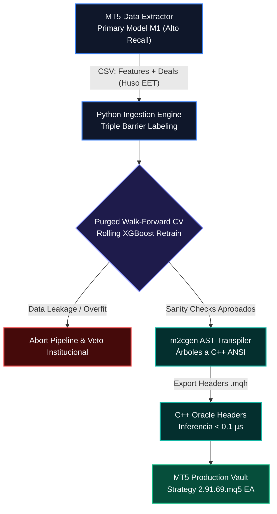

# M2 Quant Pipeline: Meta-Labeling Framework


> **Veredicto Científico:** Este repositorio fue concebido para someter a prueba rigurosa el *Edge* de la estrategia basada en la Media Móvil de Hull (HMA). Las evaluaciones empíricas de este pipeline demostraron que **las Medias Móviles sufren de *Alpha Decay* irreversible y no generan exceso de retorno en mercados electrónicos líquidos**. Se documenta el desmontaje científico de la HMA para evitar pérdidas de capital y consolidar un estándar institucional de auditoría cuantitativa.

Aunque la estrategia HMA murió, **la infraestructura construida aquí sobrevivió**. Este repositorio es un plano maestro institucional (*Blueprint*) que demuestra cómo diseñar, validar, transpolar a C++ y auditar modelos de *Machine Learning* para MetaTrader 5 a latencia cero (<0.1 μs).

---

## Panel Resumen del Pipeline Cuantitativo

<div class="grid cards" markdown>

<div class="metric-card" markdown>
### Latencia de Inferencia C++
**< 0.1 µs (< 100 ns)**  
<span class="badge badge--success">Sub-Microsegundo</span>  
Transpilación AST a C++ nativo compilado en la memoria caché L1 de MetaTrader 5.
</div>

<div class="metric-card" markdown>
### Cobertura de Recall en M1
**Recall ≥ 0.85 (N > 3.000)**  
<span class="badge badge--info">Alto Recall</span>  
Sobre-operativa deliberada para nutrir al modelo secundario con población densa.
</div>

<div class="metric-card" markdown>
### Paridad de Microestructura
**EET (NY 5:00 PM Close)**  
<span class="badge badge--success">5 Velas Diarias</span>  
Eliminación de la vela espuria de domingo y sincronización de spreads de rollover.
</div>

<div class="metric-card" markdown>
### Validación Purged Walk-Forward
**Cero Fuga Temporal**  
<span class="badge badge--success">Purge & Embargo</span>  
Aislamiento absoluto de solapamiento de barreras y persistencia autorregresiva.
</div>

<div class="metric-card" markdown>
### Veredicto Científico Final
**AUC OOS = 0.518 (α = 0)**  
<span class="badge badge--danger">Market Beta Trap</span>  
Desmontaje empírico de la HMA: 100% Beta de mercado en Oro, cero Alpha genuino.
</div>

</div>

---

## Arquitectura Core (M2 Pipeline)

El framework desacopla el ciclo cuantitativo en cuatro capas interconectadas:



---

## Crónica de Investigación en 4 Etapas

El ciclo de investigación se documenta en profundidad a lo largo de cuatro etapas cronológicas:

1.  **[Etapa 1: Hipótesis Cinemática HMA y Alto Recall en $M_1$](RESEARCH_JOURNAL.md#etapa-1-cinematica-de-la-hma-y-el-principio-de-alto-recall-en-meta-labeling):** Formulación de derivadas discretas (velocidad, aceleración y tirón) sobre la HMA de Alan Hull y la decisión anti-intuitiva de forzar sobre-operatividad en el modelo primario ($\text{Recall} \ge 0.85$) para nutrir con datos densos ($N > 3.000$) al modelo secundario.
2.  **[Etapa 2: Minería con StrategyQuant X y Sincronización Horaria](RESEARCH_JOURNAL.md#etapa-2-mineria-con-strategyquant-x-sincronizacion-horaria-gmt0eet-y-filtros-mtf):** Minería de alineaciones de cintas (*HMA Ribbons*), identificación de la trampa de huso horario GMT+0 vs EET (vela espuria de domingo y ensanchamiento de spreads en rollover) e inyección de 7 features continuas de régimen multitemporal (ADX H4, Keltner Bandwidth, ATR Ratio).
3.  **[Etapa 3: Transpilación a C++ a Latencia Cero (<0.1 μs)](RESEARCH_JOURNAL.md#etapa-3-transpilacion-a-c-a-latencia-cero-en-metatrader-5):** Eliminación de puentes REST y sockets en Python. Transpilación del grafo AST de XGBoost a cabeceras nativas C++/MQL5 (`M2_XGBoost_Oracle.mqh`) con evaluación sub-microsegundo protegida contra desbordamiento numérico (`MathExpSafe`).
4.  **[Etapa 4: Falsación Matemática Definitiva](RESEARCH_JOURNAL.md#etapa-4-falsacion-matematica-definitiva-alpha-decay-y-la-trampa-del-market-beta):** Validación cruzada Purged Walk-Forward Montecarlo que desmanteló la ilusión de rentabilidad, demostrando que el balance alcista era $100\%$ *Market Beta* en Oro ($AUC_{\text{OOS}} = 0.518$) y exponiendo el retardo insalvable frente a algoritmos HFT.

---

## Principios Cuantitativos Universales Transferibles

A partir de los hallazgos de este proyecto, se han formulado tres principios universales transferibles a cualquier desarrollo algorítmico institucional en [Principios Cuantitativos Universales](UNIVERSAL_PRINCIPLES.md):

*   **Principio 1: Descomposición Rigurosa de Alpha vs. Market Beta:** Descomposición formal multifactorial ($R_{p} = \alpha + \beta R_{m} + \epsilon$), pruebas de simetría direccional y aplicación del *Deflated Sharpe Ratio* (DSR) para neutralizar el sesgo de selección en minería genética.
*   **Principio 2: Diseño del Tradeoff Precision/Recall en Meta-Labeling:** Por qué el modelo primario debe optimizar exhaustividad ($\text{Recall} \to 1.0$) aceptando ruido, mientras el modelo secundario optimiza la precisión calibrada en función del Valor Esperado ($EV$) y modula el dimensionamiento continuo (*Bet Sizing*).
*   **Principio 3: Protocolo Institucional de Auditoría Previa a Capital Real:** El checklist de 5 puertas de auditoría (Cero Fuga Temporal, Paridad Horaria EET, Purged CV con $AUC_{\text{OOS}} \ge 0.55$, Degradación IS/OOS $\le 30\%$ y Latencia Nativa $<1\ \mu\text{s}$) antes de asignar capital real.

---

## Mapa del Repositorio

El repositorio se organiza estrictamente en dos ecosistemas técnicos y una bóveda documental:

```text
HMA_MetaLabeling/
├── python/                         # Motor Estadístico y de Machine Learning
│   ├── main.py                     # Panel de control orquestador (CLI interactivo / headless)
│   └── m2_metalabeling/            # Paquete modular institucional
│       ├── ingestion/              # Ingesta y lectura de ticks/barras MT5 (mt5_reader.py)
│       ├── labeling/               # Etiquetado Triple Barrera (triple_barrier.py)
│       ├── cross_validation/       # Purged K-Fold con Embargo (purged_cv.py)
│       ├── calibration/            # Calibración isotónica y Bet Sizing
│       ├── export/                 # Transpilación a C++/MQL5 (to_mqh.py, export_mql5.py)
│       └── models/                 # Modelos Walk-Forward, retrain y auditoría
├── mql5/                           # Ecosistema MetaTrader 5
│   ├── Include/                    # Cabeceras (.mqh), logger ML y oráculos C++ transpilados
│   └── Experts/                    # Asesores expertos (Discovery, Extractores y Producción)
├── portfolio/                      # Bóveda desplegada multiactivo (AUDUSD, EURUSD, XAUUSD...)
├── docs/                           # Portal de Documentación Científica (MkDocs Material)
│   ├── index.md                    # Portada del portal
│   ├── METHODOLOGY.md              # Formulación matemática del framework M2
│   ├── RESEARCH_JOURNAL.md         # Crónica de investigación en 4 etapas
│   ├── UNIVERSAL_PRINCIPLES.md     # Principios cuantitativos universales
│   ├── HISTORICAL_EVOLUTION.md     # Evolución histórica de prototipos algorítmicos
│   ├── POST_MORTEM.md              # Análisis forense y veredicto científico
│   └── assets/                     # Gráficas empíricas (WFM Equity, IS/OOS Robustness)
└── tests/                          # Suite de pruebas automatizadas (pytest)
```

---

## Guía de Trabajo: Flujo de Ejecución (Panel CLI)

Para orquestar el flujo de datos sin necesidad de invocar scripts individuales, el repositorio proporciona una consola CLI con soporte tanto interactivo como desatendido (*Headless*):

```bash
# Modo interactivo
python python/main.py

# Modo desatendido para pipelines CI/CD
python python/main.py --all --non-interactive
python python/main.py --step 1 --non-interactive
```

Al iniciarse en modo interactivo, se despliega el panel de control:

```text
============================================================
    M2 QUANT PIPELINE - INSTITUTIONAL CONTROL PANEL     
============================================================
 Basado en Marcos López de Prado (Advances in Financial ML)
 Framework de latencia cero para MetaTrader 5
============================================================

[ FLUJO DE EJECUCIÓN (WORKFLOW) ]
  1. Ingestar Datos y Aplicar Triple-Barrera (Meta-Labeling)
  2. Entrenar Modelos (Purged Walk-Forward Montecarlo)
  3. Auditoría Estricta contra Fuga de Datos (Sanity Check)
  4. Transpilar Oráculo a C++ (MQL5 0ms Latency)
  5. Ejecutar Flujo Completo (Portfolio Auto-Batch)
```

---

## Navegación del Portal Documental

*   **[Metodología Cuantitativa](METHODOLOGY.md):** Formulación matemática completa de la Triple Barrera, Purged CV con Embargo y transpilación C++.
*   **[Cuaderno de Investigación](RESEARCH_JOURNAL.md):** Crónica detallada de las 4 etapas del proyecto, desde la hipótesis cinemática hasta la falsación.
*   **[Principios Cuantitativos Universales](UNIVERSAL_PRINCIPLES.md):** Guía institucional transferible sobre descomposición de Alpha/Beta, Meta-Labeling y auditoría pre-live.
*   **[Evolución Histórica de Prototipos](HISTORICAL_EVOLUTION.md):** Recorrido por las versiones de asesores expertos, modelos ONNX y experimentos de RL.
*   **[Veredicto y Post-Mortem](POST_MORTEM.md):** Análisis forense de la defunción del Alpha de la HMA y el examen de microestructura HFT.
